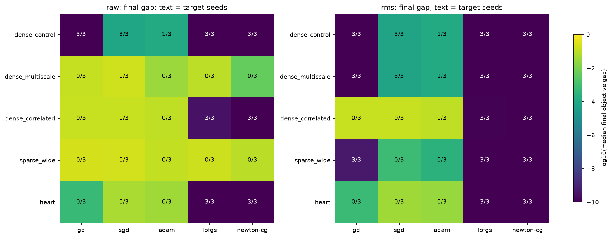
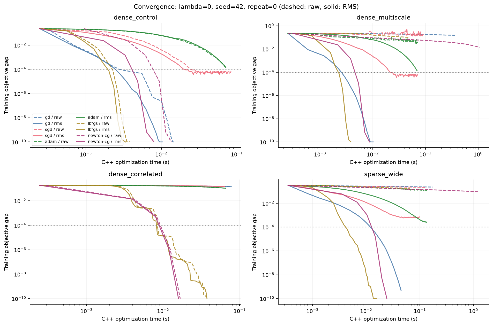
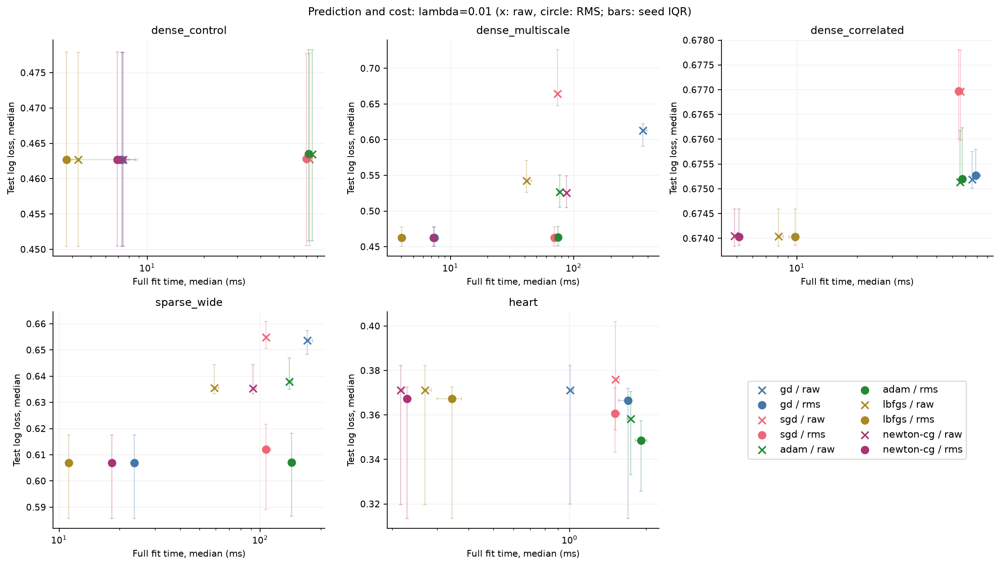

# LogitLab optimizer benchmark

[中文版](benchmark.zh-CN.md)

Five optimizers fit one binary logistic regression model. This compares convergence, prediction and cost; the hypothesis class is the same.

## Main findings

- **Scaling resolves unit imbalance:** multiscale L-BFGS final-target seeds 0/3 → 3/3; median test log loss 0.545 → 0.462.
- **Scaling does not remove correlation:** correlated RMS final-target seeds: gd 0/3, sgd 0/3, adam 0/3, lbfgs 3/3, newton-cg 3/3.
- **Optimization and generalization differ:** sparse L-BFGS test log loss raw λ=0 0.653, RMS λ=0 0.713, RMS λ=0.01 0.607. Check the training gaps and regularization together; a smaller training objective does not guarantee a better test score.

## Evidence and reproduction

972 measured fits; 3 seeds, 3 timed repeats per configuration. References passing gradient check: 60/60.

[JSON](../../results/2026-10-15/results.json) · [Metrics CSV](../../results/2026-10-15/metrics.csv) · [Traces CSV](../../results/2026-10-15/traces.csv) · [Summary JSON](summary.json) · [Report manifest](report-manifest.json)

~~~bash
python -m pip install '.[test,benchmark]'
python benchmarks/suite.py --cases dense_control dense_multiscale dense_correlated sparse_wide heart --seeds 42 43 44 --l2 0.0 0.01 --epochs 100 --batch-size 256 --repeats 3 --target-gap 0.0001 --output build/benchmark-suite
python benchmarks/report.py --input build/benchmark-suite --output build/benchmark-report
~~~

These reproduce the recorded experiment settings. A small protocol check uses --quick --cases dense_control --seeds 42 --epochs 2 --repeats 1. Quick results are not performance evidence.

Actual settings: λ=[0.0, 0.01]; seeds=[42, 43, 44]; quick=False.

- CPU: AMD EPYC 9V74 80-Core Processor; affinity: [0, 1, 2, 3, 4].
- Python 3.12.14; NumPy 2.5.4; SciPy 1.18.1; LogitLab 0.2.0.
- g++ (Debian 14.2.0-19) 14.2.0; MemTotal:       34906040 kB.
- Single-thread core/BLAS, portable Release build. CPU frequency is not isolated. JSON retains commit, dirty-tree state, source/binary hashes and NumPy build metadata.

## Protocol

Stratified 70/15/15 train/validation/test splits are shared within each seed. RMS uses training rows only, without centering; CSR stays sparse and zero-RMS columns use scale 1. Validation metrics are retained, but neither validation nor test labels select configurations.

Two tracks: λ=0 isolates coordinate conditioning since nonzero feature rescaling preserves attainable predictions. λ=0.01 studies the practical pipeline: isotropic L2 after scaling changes the penalty on original coefficients. Its predictive changes cannot be attributed to conditioning alone. There is no λ search.

Calibration: GD rates 0.05/0.5/5; SGD 0.001/0.01/0.1; Adam 0.0001/0.001/0.01. Select the lowest FINAL TRAINING objective and refit from zero. L-BFGS/Newton-CG each use one configuration with line search. Search budgets differ; calibration time is separate. This bounded grid cannot establish a fully tuned winner.

The independent SciPy Newton-CG/L-BFGS-B reference has a separately written objective, gradient and exact HVP. RMS preconditioning transforms the penalty to λ/scale², preserving the original objective even on raw features. A preconditioned full-gradient norm ≤1e-5 validates the reference; materially better library results invalidate gap/target statistics. Target: objective gap ≤1e-4.

Fit timing includes Python conversion, C++ validation and workspace allocation. C++ trace/target time excludes these. Small training and prediction warm-ups precede timing. Prediction uses seven calls per fit, includes conversion, excludes preprocessing. All solvers share the same prediction kernels; small throughput differences do not establish an optimizer-specific predictor advantage. RSS is whole isolated-worker peak across repetitions, including interpreter/data/warm-up, not incremental solver memory. Linux uses post-exec VmHWM to exclude inherited launcher high-water marks. Workers run sequentially.

Aggregate repetitions within each seed first, then report median [Q1,Q3] across seed medians. Repeated timing is not an independent dataset. Three seeds are descriptive evidence, not significance tests. ROC-AUC uses average ranks for ties; accuracy threshold is 0.5; Brier is mean squared probability error. Test log loss clips probabilities to [1e-15,1−1e-15].

Budget per trial: 100 epochs/outer steps, batch=256 (except ablations), tolerance=1e-6, zero initialization.

| Scenario | Shape | Storage | Purpose |
| --- | --- | --- | --- |
| dense_control | 6000 × 48 | dense | Comparable-scale Gaussian control. |
| dense_multiscale | 6000 × 48 | dense | Factors 0.01–100; label signal generated before rescaling. |
| dense_correlated | 6000 × 48 | dense | Four-feature correlated groups, noise 0.05, opposing coefficients. RMS does not whiten. |
| sparse_wide | 12000 × 1500 | csr | CSR density 0.01 (quick: 0.08), factors 0.01–100; sparse traversal and dense updates. |
| heart | 270 × 13 | dense | Bundled LIBSVM heart_scale; +1→1/−1→0, unspecified coordinates→0, no imputation; already scaled upstream. |

Heart provenance: [LIBSVM](https://www.csie.ntu.edu.tw/~cjlin/libsvmtools/datasets/binary.html#heart); file checksum in JSON. Already-scaled heart is not a raw clinical scaling experiment. Its small timings include substantial interface overhead; current splits cannot be compared to historical data/README.md AUC.

## Scaling and convergence

λ=0. Color: log10 median final gap; text: FINAL target seeds / seeds. Plotting floor: 1e-10.

First seed/repeat examples, not averages. Dashed: raw; solid: RMS. Dotted: target. SGD/Adam can cross the target and later move away.

## Prediction and cost

λ=0.01; x: raw, circle: RMS; bars: seed IQR. A shorter fit is not faster convergence if its target was missed. Overlapping seed ranges limit conclusions about small score differences.

### dense_control

| λ | Scaling | Solver | Test log loss [Q1,Q3] | ROC-AUC | Accuracy % | Brier | Final gap | Final target |
| --- | --- | --- | --- | --- | --- | --- | --- | --- |
| 0.0 | raw | gd | 0.462 [0.447, 0.477] | 0.856 | 75.2 | 0.154 | 6.55e-12 | 3/3 |
| 0.0 | raw | sgd | 0.462 [0.447, 0.477] | 0.856 | 75.0 | 0.154 | 7.30e-05 | 3/3 |
| 0.0 | raw | adam | 0.462 [0.448, 0.477] | 0.856 | 75.4 | 0.154 | 1.29e-04 | 1/3 |
| 0.0 | raw | lbfgs | 0.462 [0.447, 0.477] | 0.856 | 75.2 | 0.154 | 8.95e-13 | 3/3 |
| 0.0 | raw | newton-cg | 0.462 [0.447, 0.477] | 0.856 | 75.2 | 0.154 | 0.00e+00 | 3/3 |
| 0.0 | rms | gd | 0.462 [0.447, 0.477] | 0.856 | 75.2 | 0.154 | 6.72e-12 | 3/3 |
| 0.0 | rms | sgd | 0.462 [0.447, 0.477] | 0.856 | 75.0 | 0.154 | 7.22e-05 | 3/3 |
| 0.0 | rms | adam | 0.462 [0.448, 0.477] | 0.856 | 75.4 | 0.154 | 1.32e-04 | 1/3 |
| 0.0 | rms | lbfgs | 0.462 [0.447, 0.477] | 0.856 | 75.2 | 0.154 | 9.71e-13 | 3/3 |
| 0.0 | rms | newton-cg | 0.462 [0.447, 0.477] | 0.856 | 75.2 | 0.154 | 0.00e+00 | 3/3 |
| 0.01 | raw | gd | 0.463 [0.450, 0.478] | 0.856 | 75.0 | 0.154 | 2.67e-12 | 3/3 |
| 0.01 | raw | sgd | 0.463 [0.451, 0.478] | 0.856 | 74.9 | 0.154 | 7.70e-05 | 3/3 |
| 0.01 | raw | adam | 0.463 [0.451, 0.478] | 0.856 | 75.4 | 0.154 | 4.16e-05 | 2/3 |
| 0.01 | raw | lbfgs | 0.463 [0.450, 0.478] | 0.856 | 75.0 | 0.154 | 3.72e-13 | 3/3 |
| 0.01 | raw | newton-cg | 0.463 [0.450, 0.478] | 0.856 | 75.0 | 0.154 | 3.68e-13 | 3/3 |
| 0.01 | rms | gd | 0.463 [0.450, 0.478] | 0.856 | 75.0 | 0.154 | 2.72e-12 | 3/3 |
| 0.01 | rms | sgd | 0.463 [0.451, 0.478] | 0.856 | 75.0 | 0.154 | 7.62e-05 | 3/3 |
| 0.01 | rms | adam | 0.464 [0.451, 0.478] | 0.856 | 75.5 | 0.154 | 4.17e-05 | 2/3 |
| 0.01 | rms | lbfgs | 0.463 [0.450, 0.478] | 0.856 | 75.0 | 0.154 | 7.24e-14 | 3/3 |
| 0.01 | rms | newton-cg | 0.463 [0.450, 0.478] | 0.856 | 75.0 | 0.154 | 3.65e-13 | 3/3 |

| λ | Scaling | Solver | Fit ms [Q1,Q3] | Target C++ ms | Ever target | Target passes | Total passes | Predict M rows/s | Worker RSS MiB | Calibration ms |
| --- | --- | --- | --- | --- | --- | --- | --- | --- | --- | --- |
| 0.0 | raw | gd | 11.34 [10.00, 12.30] | 2.71 | 3/3 | 7.0 | 29.0 | 7.720 | 81.4 | 86.66 |
| 0.0 | raw | sgd | 71.74 [69.45, 77.92] | 22.12 | 3/3 | 59.0 | 201.0 | 7.915 | 81.4 | 208.33 |
| 0.0 | raw | adam | 75.73 [73.36, 78.86] | 69.97 | 1/3 | 201.0 | 201.0 | 7.492 | 81.4 | 208.13 |
| 0.0 | raw | lbfgs | 4.07 [4.06, 4.09] | 2.13 | 3/3 | 6.0 | 10.0 | 8.110 | 81.5 | 5.05 |
| 0.0 | raw | newton-cg | 8.55 [8.48, 8.98] | 4.79 | 3/3 | 22.0 | 36.0 | 8.168 | 81.4 | 8.59 |
| 0.0 | rms | gd | 11.10 [9.90, 12.76] | 2.48 | 3/3 | 7.0 | 29.0 | 8.198 | 81.5 | 83.20 |
| 0.0 | rms | sgd | 71.23 [70.93, 74.06] | 20.71 | 3/3 | 59.0 | 201.0 | 7.644 | 81.4 | 220.79 |
| 0.0 | rms | adam | 70.44 [69.50, 70.86] | 70.52 | 1/3 | 201.0 | 201.0 | 7.693 | 81.4 | 229.59 |
| 0.0 | rms | lbfgs | 3.96 [3.79, 3.97] | 2.07 | 3/3 | 6.0 | 10.0 | 8.154 | 81.4 | 4.59 |
| 0.0 | rms | newton-cg | 8.72 [8.67, 8.89] | 4.98 | 3/3 | 22.0 | 36.0 | 8.280 | 81.5 | 9.69 |
| 0.01 | raw | gd | 7.43 [7.06, 8.64] | 1.63 | 3/3 | 5.0 | 20.0 | 8.316 | 81.5 | 80.63 |
| 0.01 | raw | sgd | 72.79 [71.77, 75.24] | 17.51 | 3/3 | 49.0 | 201.0 | 7.757 | 81.5 | 211.34 |
| 0.01 | raw | adam | 75.12 [75.06, 75.62] | 61.24 | 2/3 | 168.0 | 201.0 | 7.403 | 81.5 | 223.31 |
| 0.01 | raw | lbfgs | 4.29 [3.97, 4.32] | 2.19 | 3/3 | 6.0 | 10.0 | 7.490 | 81.4 | 3.94 |
| 0.01 | raw | newton-cg | 7.41 [7.35, 7.78] | 5.14 | 3/3 | 22.0 | 29.0 | 7.702 | 81.4 | 8.51 |
| 0.01 | rms | gd | 7.32 [6.88, 7.99] | 1.64 | 3/3 | 5.0 | 20.0 | 8.314 | 81.5 | 80.50 |
| 0.01 | rms | sgd | 70.08 [68.75, 72.63] | 16.38 | 3/3 | 49.0 | 201.0 | 7.705 | 81.5 | 210.55 |
| 0.01 | rms | adam | 71.93 [71.40, 72.42] | 59.15 | 2/3 | 168.0 | 201.0 | 7.868 | 81.5 | 210.82 |
| 0.01 | rms | lbfgs | 3.71 [3.67, 8.87] | 1.99 | 3/3 | 6.0 | 10.0 | 8.223 | 81.5 | 4.06 |
| 0.01 | rms | newton-cg | 6.94 [6.83, 7.58] | 4.91 | 3/3 | 22.0 | 29.0 | 8.282 | 81.5 | 6.97 |

### dense_multiscale

| λ | Scaling | Solver | Test log loss [Q1,Q3] | ROC-AUC | Accuracy % | Brier | Final gap | Final target |
| --- | --- | --- | --- | --- | --- | --- | --- | --- |
| 0.0 | raw | gd | 0.613 [0.591, 0.622] | 0.726 | 67.3 | 0.212 | 1.32e-01 | 0/3 |
| 0.0 | raw | sgd | 0.663 [0.647, 0.725] | 0.692 | 64.3 | 0.227 | 1.89e-01 | 0/3 |
| 0.0 | raw | adam | 0.473 [0.472, 0.501] | 0.850 | 75.8 | 0.157 | 3.27e-02 | 0/3 |
| 0.0 | raw | lbfgs | 0.545 [0.527, 0.572] | 0.797 | 73.1 | 0.184 | 9.83e-02 | 0/3 |
| 0.0 | raw | newton-cg | 0.463 [0.459, 0.480] | 0.856 | 75.6 | 0.154 | 4.22e-03 | 0/3 |
| 0.0 | rms | gd | 0.462 [0.447, 0.477] | 0.856 | 75.2 | 0.154 | 6.72e-12 | 3/3 |
| 0.0 | rms | sgd | 0.462 [0.447, 0.477] | 0.856 | 75.0 | 0.154 | 7.22e-05 | 3/3 |
| 0.0 | rms | adam | 0.462 [0.448, 0.477] | 0.856 | 75.4 | 0.154 | 1.32e-04 | 1/3 |
| 0.0 | rms | lbfgs | 0.462 [0.447, 0.477] | 0.856 | 75.2 | 0.154 | 9.71e-13 | 3/3 |
| 0.0 | rms | newton-cg | 0.462 [0.447, 0.477] | 0.856 | 75.2 | 0.154 | 0.00e+00 | 3/3 |
| 0.01 | raw | gd | 0.613 [0.591, 0.622] | 0.726 | 67.3 | 0.212 | 6.20e-02 | 0/3 |
| 0.01 | raw | sgd | 0.664 [0.647, 0.726] | 0.692 | 64.3 | 0.227 | 9.90e-02 | 0/3 |
| 0.01 | raw | adam | 0.527 [0.506, 0.550] | 0.815 | 74.6 | 0.176 | 1.34e-03 | 0/3 |
| 0.01 | raw | lbfgs | 0.543 [0.526, 0.571] | 0.799 | 73.5 | 0.183 | 1.28e-02 | 0/3 |
| 0.01 | raw | newton-cg | 0.526 [0.505, 0.549] | 0.816 | 75.2 | 0.175 | 8.45e-13 | 3/3 |
| 0.01 | rms | gd | 0.463 [0.450, 0.478] | 0.856 | 75.0 | 0.154 | 2.72e-12 | 3/3 |
| 0.01 | rms | sgd | 0.463 [0.451, 0.478] | 0.856 | 75.0 | 0.154 | 7.62e-05 | 3/3 |
| 0.01 | rms | adam | 0.464 [0.451, 0.478] | 0.856 | 75.5 | 0.154 | 4.17e-05 | 2/3 |
| 0.01 | rms | lbfgs | 0.463 [0.450, 0.478] | 0.856 | 75.0 | 0.154 | 7.22e-14 | 3/3 |
| 0.01 | rms | newton-cg | 0.463 [0.450, 0.478] | 0.856 | 75.0 | 0.154 | 3.65e-13 | 3/3 |

| λ | Scaling | Solver | Fit ms [Q1,Q3] | Target C++ ms | Ever target | Target passes | Total passes | Predict M rows/s | Worker RSS MiB | Calibration ms |
| --- | --- | --- | --- | --- | --- | --- | --- | --- | --- | --- |
| 0.0 | raw | gd | 355.56 [346.85, 359.38] | — | 0/3 | — | 966.0 | 7.484 | 81.5 | 1079.43 |
| 0.0 | raw | sgd | 74.75 [72.88, 79.61] | — | 0/3 | — | 201.0 | 7.810 | 81.5 | 211.27 |
| 0.0 | raw | adam | 71.73 [71.53, 72.02] | — | 0/3 | — | 201.0 | 7.682 | 81.5 | 216.84 |
| 0.0 | raw | lbfgs | 44.25 [44.12, 45.86] | — | 0/3 | — | 118.0 | 8.078 | 81.5 | 47.35 |
| 0.0 | raw | newton-cg | 1058.43 [1052.89, 1079.07] | — | 0/3 | — | 5101.0 | 7.555 | 81.5 | 1086.28 |
| 0.0 | rms | gd | 10.85 [9.91, 11.69] | 2.56 | 3/3 | 7.0 | 29.0 | 7.931 | 81.5 | 91.45 |
| 0.0 | rms | sgd | 71.62 [70.27, 72.16] | 21.20 | 3/3 | 59.0 | 201.0 | 7.884 | 81.5 | 210.54 |
| 0.0 | rms | adam | 74.25 [71.24, 74.72] | 74.40 | 1/3 | 201.0 | 201.0 | 8.148 | 81.5 | 222.04 |
| 0.0 | rms | lbfgs | 4.23 [4.08, 4.25] | 2.31 | 3/3 | 6.0 | 10.0 | 8.093 | 81.5 | 4.31 |
| 0.0 | rms | newton-cg | 9.22 [8.85, 9.25] | 5.17 | 3/3 | 22.0 | 36.0 | 8.277 | 81.5 | 8.80 |
| 0.01 | raw | gd | 364.12 [359.13, 390.93] | — | 0/3 | — | 966.0 | 7.828 | 81.5 | 1125.75 |
| 0.01 | raw | sgd | 73.79 [72.85, 74.24] | — | 0/3 | — | 201.0 | 7.721 | 81.5 | 216.82 |
| 0.01 | raw | adam | 77.34 [74.58, 78.78] | — | 0/3 | — | 201.0 | 7.715 | 81.5 | 225.98 |
| 0.01 | raw | lbfgs | 41.54 [41.44, 45.62] | — | 0/3 | — | 116.0 | 7.782 | 81.5 | 45.95 |
| 0.01 | raw | newton-cg | 87.45 [86.63, 88.29] | 32.41 | 3/3 | 154.0 | 409.0 | 7.989 | 81.5 | 88.92 |
| 0.01 | rms | gd | 7.41 [6.88, 7.80] | 1.78 | 3/3 | 5.0 | 20.0 | 8.070 | 81.5 | 80.75 |
| 0.01 | rms | sgd | 69.59 [69.30, 69.98] | 16.90 | 3/3 | 49.0 | 201.0 | 7.996 | 81.5 | 220.95 |
| 0.01 | rms | adam | 74.48 [72.60, 76.11] | 63.42 | 2/3 | 168.0 | 201.0 | 8.038 | 81.5 | 219.01 |
| 0.01 | rms | lbfgs | 4.02 [3.88, 4.19] | 2.15 | 3/3 | 6.0 | 10.0 | 7.662 | 81.5 | 4.38 |
| 0.01 | rms | newton-cg | 7.27 [7.20, 7.79] | 5.01 | 3/3 | 22.0 | 29.0 | 8.004 | 81.5 | 7.17 |

### dense_correlated

| λ | Scaling | Solver | Test log loss [Q1,Q3] | ROC-AUC | Accuracy % | Brier | Final gap | Final target |
| --- | --- | --- | --- | --- | --- | --- | --- | --- |
| 0.0 | raw | gd | 0.653 [0.653, 0.653] | 0.753 | 62.9 | 0.230 | 1.41e-01 | 0/3 |
| 0.0 | raw | sgd | 0.663 [0.662, 0.664] | 0.688 | 61.1 | 0.235 | 1.50e-01 | 0/3 |
| 0.0 | raw | adam | 0.622 [0.621, 0.624] | 0.794 | 68.6 | 0.216 | 1.08e-01 | 0/3 |
| 0.0 | raw | lbfgs | 0.521 [0.512, 0.526] | 0.816 | 74.7 | 0.175 | 3.19e-10 | 3/3 |
| 0.0 | raw | newton-cg | 0.521 [0.512, 0.526] | 0.816 | 74.7 | 0.175 | 2.77e-12 | 3/3 |
| 0.0 | rms | gd | 0.653 [0.653, 0.654] | 0.745 | 63.0 | 0.230 | 1.41e-01 | 0/3 |
| 0.0 | rms | sgd | 0.663 [0.662, 0.664] | 0.688 | 61.2 | 0.235 | 1.50e-01 | 0/3 |
| 0.0 | rms | adam | 0.622 [0.621, 0.624] | 0.793 | 68.6 | 0.216 | 1.08e-01 | 0/3 |
| 0.0 | rms | lbfgs | 0.521 [0.512, 0.526] | 0.816 | 74.7 | 0.175 | 1.15e-10 | 3/3 |
| 0.0 | rms | newton-cg | 0.521 [0.512, 0.526] | 0.816 | 74.7 | 0.175 | 2.77e-12 | 3/3 |
| 0.01 | raw | gd | 0.675 [0.675, 0.676] | 0.630 | 56.7 | 0.241 | 4.99e-05 | 3/3 |
| 0.01 | raw | sgd | 0.677 [0.676, 0.678] | 0.601 | 57.0 | 0.242 | 7.36e-04 | 0/3 |
| 0.01 | raw | adam | 0.675 [0.675, 0.676] | 0.623 | 57.1 | 0.241 | 5.16e-04 | 0/3 |
| 0.01 | raw | lbfgs | 0.674 [0.674, 0.675] | 0.638 | 56.9 | 0.241 | 5.57e-12 | 3/3 |
| 0.01 | raw | newton-cg | 0.674 [0.674, 0.675] | 0.638 | 56.9 | 0.241 | 1.62e-13 | 3/3 |
| 0.01 | rms | gd | 0.675 [0.675, 0.676] | 0.629 | 56.8 | 0.241 | 6.60e-05 | 3/3 |
| 0.01 | rms | sgd | 0.677 [0.676, 0.678] | 0.600 | 57.1 | 0.242 | 7.32e-04 | 0/3 |
| 0.01 | rms | adam | 0.675 [0.675, 0.676] | 0.623 | 57.2 | 0.241 | 5.23e-04 | 0/3 |
| 0.01 | rms | lbfgs | 0.674 [0.674, 0.675] | 0.638 | 56.9 | 0.241 | 2.40e-12 | 3/3 |
| 0.01 | rms | newton-cg | 0.674 [0.674, 0.675] | 0.638 | 56.9 | 0.241 | 1.32e-13 | 3/3 |

| λ | Scaling | Solver | Fit ms [Q1,Q3] | Target C++ ms | Ever target | Target passes | Total passes | Predict M rows/s | Worker RSS MiB | Calibration ms |
| --- | --- | --- | --- | --- | --- | --- | --- | --- | --- | --- |
| 0.0 | raw | gd | 77.02 [76.80, 79.79] | — | 0/3 | — | 226.0 | 8.180 | 81.7 | 150.27 |
| 0.0 | raw | sgd | 65.33 [65.24, 66.25] | — | 0/3 | — | 201.0 | 8.174 | 81.7 | 198.00 |
| 0.0 | raw | adam | 67.83 [67.49, 70.80] | — | 0/3 | — | 201.0 | 7.890 | 81.7 | 203.51 |
| 0.0 | raw | lbfgs | 35.52 [34.80, 37.43] | 9.11 | 3/3 | 26.0 | 100.0 | 7.864 | 81.7 | 38.07 |
| 0.0 | raw | newton-cg | 16.81 [16.40, 17.06] | 12.32 | 3/3 | 55.0 | 74.0 | 8.274 | 81.7 | 16.12 |
| 0.0 | rms | gd | 76.76 [76.73, 77.61] | — | 0/3 | — | 226.0 | 8.128 | 81.7 | 149.43 |
| 0.0 | rms | sgd | 64.60 [64.36, 66.94] | — | 0/3 | — | 201.0 | 7.935 | 81.7 | 203.88 |
| 0.0 | rms | adam | 66.81 [66.36, 68.99] | — | 0/3 | — | 201.0 | 7.964 | 81.7 | 199.45 |
| 0.0 | rms | lbfgs | 31.17 [29.50, 34.62] | 8.54 | 3/3 | 25.0 | 87.0 | 7.846 | 81.7 | 30.19 |
| 0.0 | rms | newton-cg | 17.13 [16.74, 17.25] | 12.66 | 3/3 | 57.0 | 76.0 | 7.624 | 81.7 | 17.87 |
| 0.01 | raw | gd | 75.43 [74.76, 78.99] | 65.20 | 3/3 | 200.0 | 228.0 | 8.274 | 81.8 | 145.40 |
| 0.01 | raw | sgd | 65.83 [65.05, 68.04] | — | 0/3 | — | 201.0 | 7.996 | 81.8 | 213.51 |
| 0.01 | raw | adam | 65.57 [65.41, 65.85] | — | 0/3 | — | 201.0 | 8.170 | 81.7 | 209.02 |
| 0.01 | raw | lbfgs | 8.09 [7.97, 8.57] | 3.88 | 3/3 | 12.0 | 23.0 | 8.000 | 81.7 | 9.56 |
| 0.01 | raw | newton-cg | 4.88 [4.83, 5.00] | 2.60 | 3/3 | 12.0 | 21.0 | 8.277 | 81.8 | 5.34 |
| 0.01 | rms | gd | 78.73 [77.47, 83.43] | 69.84 | 3/3 | 212.0 | 230.0 | 8.194 | 81.8 | 151.53 |
| 0.01 | rms | sgd | 64.65 [64.51, 64.90] | — | 0/3 | — | 201.0 | 8.172 | 81.7 | 209.38 |
| 0.01 | rms | adam | 67.32 [65.56, 69.13] | — | 0/3 | — | 201.0 | 8.103 | 81.7 | 200.86 |
| 0.01 | rms | lbfgs | 9.78 [9.11, 9.92] | 4.00 | 3/3 | 12.0 | 27.0 | 8.254 | 81.7 | 10.31 |
| 0.01 | rms | newton-cg | 5.11 [5.06, 5.22] | 2.91 | 3/3 | 13.0 | 22.0 | 8.333 | 81.8 | 5.33 |

### sparse_wide

| λ | Scaling | Solver | Test log loss [Q1,Q3] | ROC-AUC | Accuracy % | Brier | Final gap | Final target |
| --- | --- | --- | --- | --- | --- | --- | --- | --- |
| 0.0 | raw | gd | 0.654 [0.649, 0.658] | 0.645 | 59.2 | 0.231 | 2.28e-01 | 0/3 |
| 0.0 | raw | sgd | 0.655 [0.651, 0.662] | 0.664 | 62.2 | 0.230 | 2.17e-01 | 0/3 |
| 0.0 | raw | adam | 0.728 [0.707, 0.729] | 0.740 | 67.4 | 0.229 | 1.17e-01 | 0/3 |
| 0.0 | raw | lbfgs | 0.653 [0.650, 0.661] | 0.703 | 65.2 | 0.225 | 1.71e-01 | 0/3 |
| 0.0 | raw | newton-cg | 0.654 [0.636, 0.655] | 0.734 | 67.0 | 0.219 | 9.14e-02 | 0/3 |
| 0.0 | rms | gd | 0.713 [0.676, 0.717] | 0.782 | 70.6 | 0.213 | 4.74e-10 | 3/3 |
| 0.0 | rms | sgd | 0.718 [0.679, 0.721] | 0.782 | 70.6 | 0.213 | 6.91e-04 | 0/3 |
| 0.0 | rms | adam | 0.702 [0.667, 0.708] | 0.783 | 70.5 | 0.211 | 2.64e-04 | 0/3 |
| 0.0 | rms | lbfgs | 0.713 [0.676, 0.717] | 0.782 | 70.6 | 0.213 | 6.23e-12 | 3/3 |
| 0.0 | rms | newton-cg | 0.713 [0.676, 0.717] | 0.782 | 70.6 | 0.213 | 0.00e+00 | 3/3 |
| 0.01 | raw | gd | 0.654 [0.648, 0.657] | 0.645 | 59.5 | 0.231 | 2.10e-02 | 0/3 |
| 0.01 | raw | sgd | 0.655 [0.651, 0.661] | 0.661 | 61.5 | 0.230 | 1.46e-02 | 0/3 |
| 0.01 | raw | adam | 0.638 [0.635, 0.647] | 0.684 | 62.5 | 0.223 | 9.33e-04 | 0/3 |
| 0.01 | raw | lbfgs | 0.635 [0.633, 0.644] | 0.686 | 62.3 | 0.223 | 4.82e-05 | 3/3 |
| 0.01 | raw | newton-cg | 0.635 [0.633, 0.644] | 0.686 | 62.2 | 0.223 | 9.56e-14 | 3/3 |
| 0.01 | rms | gd | 0.607 [0.586, 0.618] | 0.786 | 70.6 | 0.198 | 8.95e-12 | 3/3 |
| 0.01 | rms | sgd | 0.612 [0.589, 0.622] | 0.784 | 70.6 | 0.200 | 9.55e-04 | 0/3 |
| 0.01 | rms | adam | 0.607 [0.587, 0.618] | 0.786 | 70.6 | 0.198 | 2.57e-04 | 0/3 |
| 0.01 | rms | lbfgs | 0.607 [0.586, 0.618] | 0.786 | 70.6 | 0.198 | 1.48e-12 | 3/3 |
| 0.01 | rms | newton-cg | 0.607 [0.586, 0.618] | 0.786 | 70.6 | 0.198 | 0.00e+00 | 3/3 |

| λ | Scaling | Solver | Fit ms [Q1,Q3] | Target C++ ms | Ever target | Target passes | Total passes | Predict M rows/s | Worker RSS MiB | Calibration ms |
| --- | --- | --- | --- | --- | --- | --- | --- | --- | --- | --- |
| 0.0 | raw | gd | 168.40 [167.84, 172.48] | — | 0/3 | — | 360.0 | 5.222 | 83.0 | 563.63 |
| 0.0 | raw | sgd | 110.26 [107.69, 111.43] | — | 0/3 | — | 201.0 | 5.153 | 83.0 | 325.03 |
| 0.0 | raw | adam | 136.83 [135.85, 143.63] | — | 0/3 | — | 201.0 | 5.138 | 83.0 | 420.71 |
| 0.0 | raw | lbfgs | 63.19 [62.80, 63.26] | — | 0/3 | — | 105.0 | 5.309 | 83.0 | 62.54 |
| 0.0 | raw | newton-cg | 1150.83 [1148.20, 1197.92] | — | 0/3 | — | 5201.0 | 5.075 | 83.0 | 1252.34 |
| 0.0 | rms | gd | 46.67 [45.41, 47.85] | 12.63 | 3/3 | 28.0 | 101.0 | 5.072 | 83.8 | 142.27 |
| 0.0 | rms | sgd | 101.33 [101.18, 102.30] | — | 0/3 | — | 201.0 | 5.479 | 83.8 | 316.91 |
| 0.0 | rms | adam | 142.92 [139.58, 144.70] | — | 0/3 | — | 201.0 | 5.006 | 83.8 | 408.12 |
| 0.0 | rms | lbfgs | 18.19 [15.63, 22.10] | 4.48 | 3/3 | 9.0 | 26.0 | 5.133 | 83.7 | 14.91 |
| 0.0 | rms | newton-cg | 26.19 [25.94, 26.56] | 15.12 | 3/3 | 63.0 | 103.0 | 5.009 | 83.7 | 25.98 |
| 0.01 | raw | gd | 171.22 [169.81, 182.21] | — | 0/3 | — | 361.0 | 5.268 | 83.1 | 564.33 |
| 0.01 | raw | sgd | 106.67 [106.21, 106.90] | — | 0/3 | — | 201.0 | 5.158 | 83.1 | 318.94 |
| 0.01 | raw | adam | 139.20 [139.00, 144.97] | — | 0/3 | — | 201.0 | 5.152 | 83.0 | 426.82 |
| 0.01 | raw | lbfgs | 59.11 [59.09, 62.21] | 51.61 | 3/3 | 95.0 | 106.0 | 5.246 | 83.1 | 62.22 |
| 0.01 | raw | newton-cg | 91.97 [91.11, 95.40] | 32.91 | 3/3 | 157.0 | 417.0 | 5.378 | 83.0 | 96.18 |
| 0.01 | rms | gd | 23.61 [23.58, 23.76] | 5.56 | 3/3 | 12.0 | 47.0 | 5.100 | 83.8 | 118.50 |
| 0.01 | rms | sgd | 106.77 [105.67, 113.08] | — | 0/3 | — | 201.0 | 5.053 | 83.8 | 310.89 |
| 0.01 | rms | adam | 143.48 [138.52, 148.07] | — | 0/3 | — | 201.0 | 4.902 | 83.7 | 428.65 |
| 0.01 | rms | lbfgs | 11.17 [10.77, 11.53] | 3.26 | 3/3 | 7.0 | 20.0 | 5.532 | 83.8 | 11.98 |
| 0.01 | rms | newton-cg | 18.27 [18.10, 18.78] | 9.70 | 3/3 | 40.0 | 70.0 | 5.287 | 83.7 | 18.59 |

### heart

| λ | Scaling | Solver | Test log loss [Q1,Q3] | ROC-AUC | Accuracy % | Brier | Final gap | Final target |
| --- | --- | --- | --- | --- | --- | --- | --- | --- |
| 0.0 | raw | gd | 0.397 [0.320, 0.398] | 0.918 | 85.4 | 0.113 | 6.06e-04 | 0/3 |
| 0.0 | raw | sgd | 0.373 [0.349, 0.399] | 0.911 | 85.4 | 0.118 | 5.32e-02 | 0/3 |
| 0.0 | raw | adam | 0.351 [0.326, 0.363] | 0.918 | 85.4 | 0.109 | 3.68e-02 | 0/3 |
| 0.0 | raw | lbfgs | 0.402 [0.322, 0.404] | 0.920 | 85.4 | 0.114 | 1.65e-11 | 3/3 |
| 0.0 | raw | newton-cg | 0.402 [0.322, 0.404] | 0.920 | 85.4 | 0.114 | 0.00e+00 | 3/3 |
| 0.0 | rms | gd | 0.394 [0.318, 0.395] | 0.920 | 85.4 | 0.112 | 6.78e-04 | 0/3 |
| 0.0 | rms | sgd | 0.358 [0.340, 0.370] | 0.915 | 87.8 | 0.112 | 3.71e-02 | 0/3 |
| 0.0 | rms | adam | 0.344 [0.321, 0.354] | 0.923 | 87.8 | 0.107 | 2.79e-02 | 0/3 |
| 0.0 | rms | lbfgs | 0.402 [0.322, 0.404] | 0.920 | 85.4 | 0.114 | 5.56e-12 | 3/3 |
| 0.0 | rms | newton-cg | 0.402 [0.322, 0.404] | 0.920 | 85.4 | 0.114 | 0.00e+00 | 3/3 |
| 0.01 | raw | gd | 0.371 [0.320, 0.382] | 0.920 | 85.4 | 0.111 | 1.47e-06 | 3/3 |
| 0.01 | raw | sgd | 0.376 [0.353, 0.402] | 0.911 | 85.4 | 0.118 | 2.75e-02 | 0/3 |
| 0.01 | raw | adam | 0.358 [0.333, 0.371] | 0.918 | 85.4 | 0.112 | 1.60e-02 | 0/3 |
| 0.01 | raw | lbfgs | 0.371 [0.320, 0.382] | 0.920 | 85.4 | 0.111 | 7.86e-12 | 3/3 |
| 0.01 | raw | newton-cg | 0.371 [0.320, 0.382] | 0.920 | 85.4 | 0.111 | 0.00e+00 | 3/3 |
| 0.01 | rms | gd | 0.367 [0.314, 0.372] | 0.923 | 87.8 | 0.109 | 9.69e-05 | 2/3 |
| 0.01 | rms | sgd | 0.361 [0.343, 0.372] | 0.915 | 87.8 | 0.112 | 2.24e-02 | 0/3 |
| 0.01 | rms | adam | 0.349 [0.326, 0.357] | 0.923 | 87.8 | 0.108 | 1.48e-02 | 0/3 |
| 0.01 | rms | lbfgs | 0.367 [0.313, 0.373] | 0.925 | 85.4 | 0.109 | 4.83e-12 | 3/3 |
| 0.01 | rms | newton-cg | 0.367 [0.313, 0.373] | 0.925 | 85.4 | 0.109 | 0.00e+00 | 3/3 |

| λ | Scaling | Solver | Fit ms [Q1,Q3] | Target C++ ms | Ever target | Target passes | Total passes | Predict M rows/s | Worker RSS MiB | Calibration ms |
| --- | --- | --- | --- | --- | --- | --- | --- | --- | --- | --- |
| 0.0 | raw | gd | 0.98 [0.94, 1.10] | — | 0/3 | — | 103.0 | 5.593 | 74.9 | 3.47 |
| 0.0 | raw | sgd | 1.62 [1.57, 1.66] | — | 0/3 | — | 201.0 | 5.585 | 74.9 | 5.26 |
| 0.0 | raw | adam | 1.56 [1.56, 1.60] | — | 0/3 | — | 201.0 | 5.694 | 74.9 | 4.99 |
| 0.0 | raw | lbfgs | 0.42 [0.40, 0.46] | 0.13 | 3/3 | 17.0 | 37.0 | 5.616 | 74.8 | 0.55 |
| 0.0 | raw | newton-cg | 0.29 [0.27, 0.34] | 0.18 | 3/3 | 64.0 | 96.0 | 5.510 | 74.8 | 0.34 |
| 0.0 | rms | gd | 1.42 [1.38, 1.46] | — | 0/3 | — | 166.0 | 5.654 | 74.9 | 4.19 |
| 0.0 | rms | sgd | 1.74 [1.64, 1.82] | — | 0/3 | — | 201.0 | 5.562 | 74.9 | 5.41 |
| 0.0 | rms | adam | 1.69 [1.64, 1.70] | — | 0/3 | — | 201.0 | 5.562 | 74.9 | 5.58 |
| 0.0 | rms | lbfgs | 0.32 [0.31, 0.32] | 0.09 | 3/3 | 13.0 | 32.0 | 5.503 | 74.8 | 0.47 |
| 0.0 | rms | newton-cg | 0.30 [0.26, 0.32] | 0.15 | 3/3 | 62.0 | 94.0 | 5.782 | 74.8 | 0.36 |
| 0.01 | raw | gd | 1.01 [1.00, 1.03] | 0.40 | 3/3 | 63.0 | 119.0 | 5.600 | 74.9 | 3.28 |
| 0.01 | raw | sgd | 1.52 [1.51, 1.57] | — | 0/3 | — | 201.0 | 5.678 | 74.9 | 5.31 |
| 0.01 | raw | adam | 1.74 [1.68, 1.75] | — | 0/3 | — | 201.0 | 5.702 | 74.9 | 4.97 |
| 0.01 | raw | lbfgs | 0.27 [0.27, 0.28] | 0.09 | 3/3 | 12.0 | 25.0 | 5.647 | 74.8 | 0.42 |
| 0.01 | raw | newton-cg | 0.22 [0.21, 0.22] | 0.11 | 3/3 | 43.0 | 71.0 | 5.525 | 74.8 | 0.28 |
| 0.01 | rms | gd | 1.70 [1.56, 1.70] | 1.16 | 2/3 | 179.5 | 186.0 | 5.600 | 74.9 | 4.15 |
| 0.01 | rms | sgd | 1.51 [1.50, 1.58] | — | 0/3 | — | 201.0 | 5.694 | 74.9 | 6.66 |
| 0.01 | rms | adam | 1.91 [1.81, 2.01] | — | 0/3 | — | 201.0 | 5.503 | 74.9 | 5.08 |
| 0.01 | rms | lbfgs | 0.34 [0.30, 0.37] | 0.08 | 3/3 | 11.0 | 23.0 | 5.616 | 74.8 | 0.39 |
| 0.01 | rms | newton-cg | 0.23 [0.22, 0.24] | 0.11 | 3/3 | 43.0 | 73.0 | 5.503 | 74.8 | 0.31 |

A dash is missing/unreached, never zero or the budget endpoint. Target time/passes are conditional on reaching: read the count. A row visit is one objective/gradient, batch, curvature or HVP traversal of a row; passes=row visits/train rows. This proxy is not FLOPs and excludes dense vector-update costs. Rejected line searches and stochastic monitoring passes are counted.

## Algorithm ablations

| Case | λ | Solver | Variant | Fit ms | Test log loss | Final gap | Updates | Final target |
| --- | --- | --- | --- | --- | --- | --- | --- | --- |
| dense_correlated | 0.0 | lbfgs | baseline | 31.17 | 0.521 | 1.15e-10 | 82 | 3/3 |
| dense_correlated | 0.0 | lbfgs | history_3 | 39.64 | 0.521 | 6.15e-08 | 100 | 3/3 |
| dense_correlated | 0.0 | lbfgs | history_30 | 24.28 | 0.521 | 1.36e-11 | 57 | 3/3 |
| dense_correlated | 0.01 | lbfgs | baseline | 9.78 | 0.674 | 2.40e-12 | 22 | 3/3 |
| dense_correlated | 0.01 | lbfgs | history_3 | 14.69 | 0.674 | 9.06e-12 | 37 | 3/3 |
| dense_correlated | 0.01 | lbfgs | history_30 | 8.53 | 0.674 | 3.19e-12 | 20 | 3/3 |
| sparse_wide | 0.01 | adam | baseline | 143.48 | 0.607 | 2.57e-04 | 3300 | 0/3 |
| sparse_wide | 0.01 | adam | batch_1024 | 111.10 | 0.603 | 1.19e-03 | 900 | 0/3 |
| sparse_wide | 0.01 | adam | batch_32 | 395.96 | 0.593 | 7.53e-04 | 26300 | 0/3 |
| sparse_wide | 0.01 | sgd | baseline | 106.77 | 0.612 | 9.55e-04 | 3300 | 0/3 |
| sparse_wide | 0.01 | sgd | batch_1024 | 101.34 | 0.608 | 1.75e-03 | 900 | 0/3 |
| sparse_wide | 0.01 | sgd | batch_32 | 120.36 | 0.610 | 4.86e-04 | 26300 | 0/3 |

Baseline batch=256/history=10. Sparse RMS λ=0.01 compares batch 32/256/1024; correlated RMS compares history 3/10/30. Stochastic rates are recalibrated per batch. Smaller batches make more dense O(p) updates despite CSR. More L-BFGS history costs O(mp) memory/work and is not always better.

## Findings and recommendations

- Multiscale **gd**: final target raw 0/3 → RMS 3/3; test log loss 0.613 → 0.462.
- Multiscale **sgd**: final target raw 0/3 → RMS 3/3; test log loss 0.663 → 0.462.
- Multiscale **adam**: final target raw 0/3 → RMS 1/3; test log loss 0.473 → 0.462.
- Multiscale **lbfgs**: final target raw 0/3 → RMS 3/3; test log loss 0.545 → 0.462.
- Multiscale **newton-cg**: final target raw 0/3 → RMS 3/3; test log loss 0.463 → 0.462.

Use scaled L-BFGS as a batch reference; assess Newton-CG's precision against its extra HVP passes. GD is a conditioning baseline. SGD/Adam expose batch/step/noise tradeoffs: check final objective and held-out loss together. RMS balances magnitudes but does not whiten correlations. Choose deployment regularization using a separate validation protocol.

## Limits and verification

Synthetic labels and one 270-row real fixture do not establish industrial-scale performance. No streaming, multicore scaling or incremental memory is measured. Seeds change both synthetic data and splits. Local cloud timing, early stopping, constant-step noise, bounded grids and coordinate-dependent gradient norms limit ranking claims. There is no universal winner.

Tests cover split disjointness, train-only RMS/CSR, transformed regularizer and gradient, AUC ties, target censoring, actual work including failed line searches, and quick CLI. Reports are generated from raw artifacts; both versions share figures with English labels.
