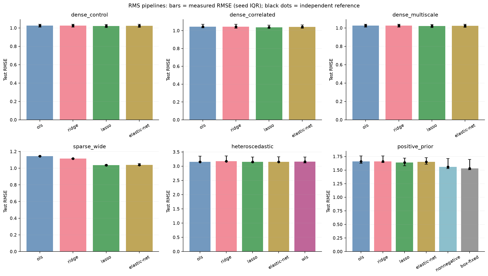
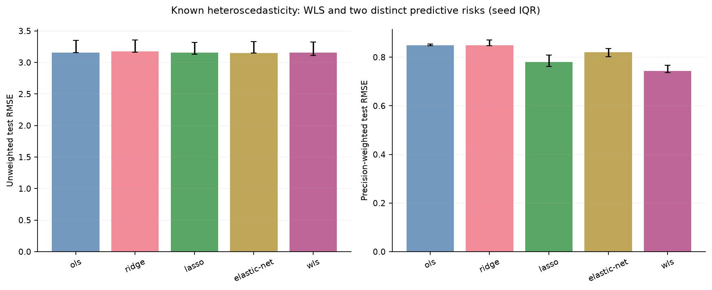
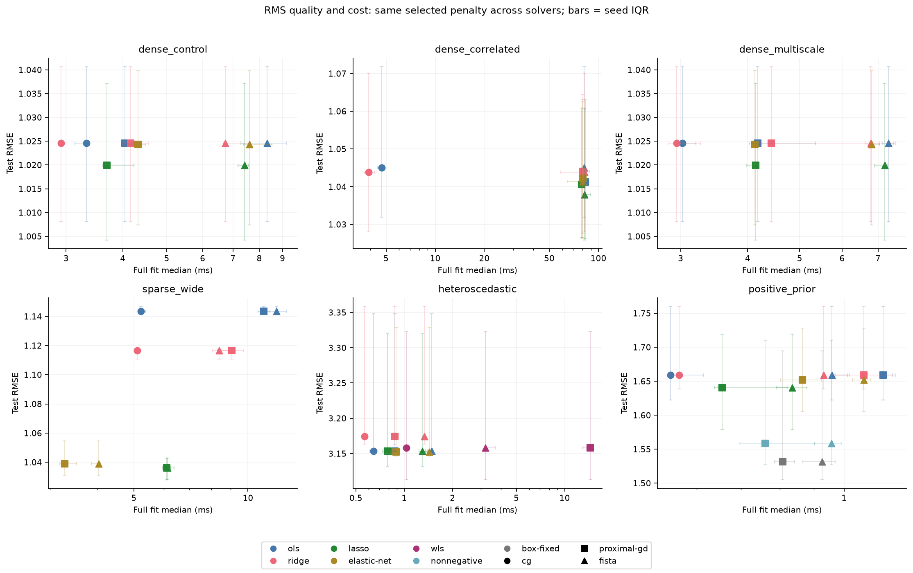
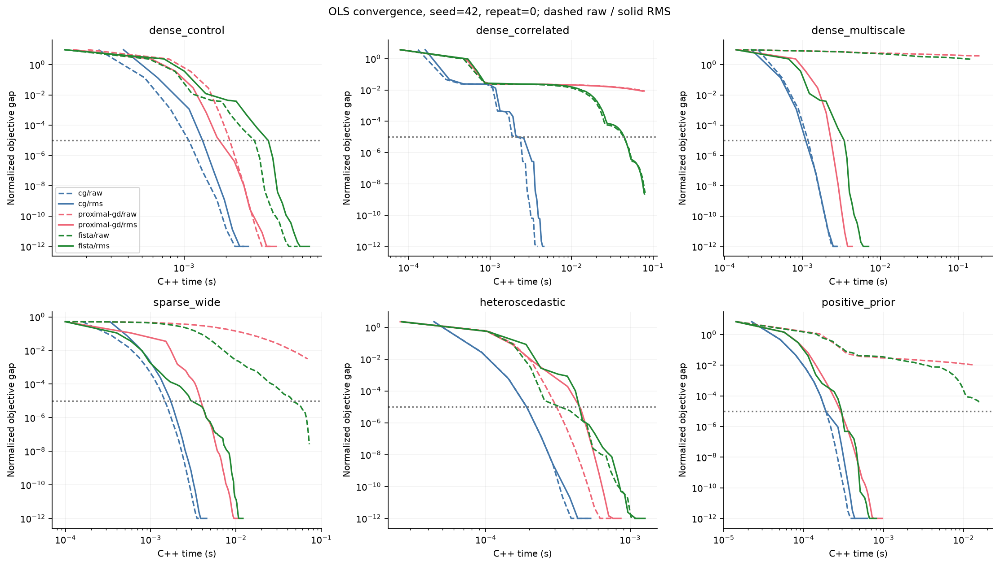

# 线性回归：模型、参数约束与优化评测

[English](linear.en.md)

OLS、Ridge、Lasso、Elastic Net 使用同一组 C++ 稠密/CSR 最小二乘内核。WLS 检验已知精度权重，非负/边界固定模型检验预先声明的领域先验。正则化模型差异与求解器收敛差异分别评估。

## 主要观察

- **sparse_wide：**ols 测试 RMSE 1.144，lasso 1.036；加权 RMSE 分别为 1.144、1.036。
- **heteroscedastic：**ols 测试 RMSE 3.154，wls 3.158；加权 RMSE 分别为 0.849、0.743。
- **positive_prior：**ols 测试 RMSE 1.659，box-fixed 1.532；加权 RMSE 分别为 1.659、1.532。
- **Scaling：**多尺度 OLS/FISTA 最终达标 原始 0/3 → RMS 3/3。CG 自带预条件的表现单独比较。

## 评测规模与复现

共 1206 次实测训练；3 个种子，每个配置 3 次重复。选中参考解 162/162 通过验证。

[Raw JSON](../../results/2026-10-16-linear/results.json) · [Metrics CSV](../../results/2026-10-16-linear/metrics.csv) · [Traces CSV](../../results/2026-10-16-linear/traces.csv) · [Summary](summary.json) · [Report manifest](report-manifest.json)

~~~bash
python -m pip install '.[test,benchmark]'
python benchmarks/linear_suite.py --cases dense_control dense_correlated dense_multiscale sparse_wide heteroscedastic positive_prior --seeds 42 43 44 --max-iter 400 --repeats 3 --target-gap 1e-05 --output build/linear-benchmark
python benchmarks/linear_report.py --input build/linear-benchmark --output build/linear-report
~~~

- CPU: AMD EPYC 9V74 80-Core Processor; affinity: [0, 1, 2, 3, 4].
- Python 3.12.14; NumPy 2.5.4; SciPy 1.18.1; scikit-learn 1.9.1; LogitLab 0.3.0.
- C++/BLAS 单线程；原始 JSON 保存源码、二进制、数据、划分和 scaler 哈希。提供 --build-cache 时记录实际构建参数；未隔离 CPU 频率和后台负载。

## 协议

按种子随机划分训练/验证/测试集约 70/15/15，所有模型与求解器共享划分。RMS 仅在训练集拟合，CSR 不减均值。测试标签不参与选参。Ridge/Lasso/Elastic Net 用独立参考实现拟合训练集，在 α={0.0001,0.001,0.01,0.1} 中按验证 MSE 选择；Elastic Net 固定 l1_ratio=0.5。其他模型没有正则搜索。随后所有适用 C++ 求解器使用相同选中目标。

目标：sum(qᵢ(yᵢ−xᵢw−b)²)/2 + l1||w||₁ + l2||w||²/2，q 总和为 1，截距不惩罚。Ridge 的 l2=α，Lasso 的 l1=α，Elastic Net 的 l1=l2=α/2。这里 Ridge 使用均值损失尺度，与 sklearn Ridge 的求和损失 α 不同。缩放改变各向同性正则含义，因此每条预处理流程重新选 α。OLS 原始/RMS 的可表达预测不变，约束按同一原始单位变换。

参考实现：独立构造并做列预条件的 NumPy SVD / SciPy 稀疏 LSMR 验证 OLS/Ridge/WLS；sklearn 循环坐标下降验证 L1；SciPy 有界最小二乘消去固定坐标后验证约束。预条件同步变换正则和边界。参考有效条件为单位步长近端映射范数 ≤1e-5、约束违反 ≤1e-10。

预算 400 次更新，容差 1e-7。CG 使用 Jacobi 预条件，不形成 XᵀX，仅适用于光滑无约束问题；近端 GD 与单调重启 FISTA 支持全部正则和边界。停止条件为单位步长近端梯度映射范数；达标条件为 (F−Fref)/(1+|Fref|) ≤ 1e-05，与算法的收敛状态分别记录。

fit 墙钟时间含 Python 转换、约束/权重设置及核心校验；C++ history 排除准备成本。计时前做小规模训练与预测预热，每次重复预测七次，所有方法共用预测内核。RSS 为 exec 后 worker VmHWM，含解释器、数据和全部重复，不是算法增量内存。选参成本为独立参考拟合及验证成本，排除首次导入、验证集评分和测试评分；它不是 C++ 调参成本。

先汇总同一种子内重复，再对种子中位数统计 median [Q1,Q3]；重复计时不是独立数据，三个种子只支持描述性结论。首次达标时间仅统计曾达标种子，破折号不表示 0 或预算终点。完整轨迹保留 repeat=0；全部重复保留计时、指标与达标计数。实验缺项时禁止生成完整报告。

| 场景 | 规模 | 存储 | 目的 |
| --- | --- | --- | --- |
| dense_control | 5000 × 40 | dense | 独立高斯特征、稀疏有符号系数。 |
| dense_correlated | 2400 × 48 | dense | 每四列强相关、噪声 0.05；研究收缩与病态条件。 |
| dense_multiscale | 5000 × 40 | dense | 量级倍率 0.01–100，系数同步变换以保持信号。 |
| sparse_wide | 6000 × 1000 | csr | CSR 密度 0.01（quick 为 0.15），稀疏真系数、高维噪声估计。 |
| heteroscedastic | 1800 × 24 | dense | 已知 sigma=0.15+3|x0|；WLS 使用 1/sigma²，其他模型不加权。 |
| positive_prior | 500 × 40 | dense | 真实系数在 [0,0.5]，w0=0.2 在响应生成前声明；边界为已知领域先验。 |

全部为合成数据；先验和噪声精度由生成机制给定，不从测试响应估计。结果不能证明工业规模性能或真实领域精度。

## 默认流程：效果与参考解

预先规定 OLS/Ridge/WLS 使用 CG，L1/约束使用 FISTA，不根据测试效果选择求解器。黑点为参考预测，不是测试误差下界。

| 场景 | 模型 | 求解器 | 测试 RMSE [Q1,Q3] | 参考 RMSE | R² | 非零系数 | Support F1 | 训练 ms |
| --- | --- | --- | --- | --- | --- | --- | --- | --- |
| dense_control | ols | cg | 1.025 [1.008, 1.041] | 1.025 | 0.961 | 40 | 0.333 | 3.33 |
| dense_control | ridge | cg | 1.025 [1.008, 1.041] | 1.025 | 0.961 | 40 | 0.333 | 2.92 |
| dense_control | lasso | fista | 1.020 [1.004, 1.037] | 1.020 | 0.961 | 24 | 0.500 | 7.43 |
| dense_control | elastic-net | fista | 1.024 [1.007, 1.040] | 1.024 | 0.961 | 31 | 0.410 | 7.60 |
| dense_correlated | ols | cg | 1.045 [1.032, 1.072] | 1.045 | 0.950 | 48 | 0.316 | 4.71 |
| dense_correlated | ridge | cg | 1.044 [1.028, 1.070] | 1.044 | 0.950 | 48 | 0.316 | 3.92 |
| dense_correlated | lasso | fista | 1.038 [1.026, 1.061] | 1.038 | 0.951 | 18 | 0.519 | 82.14 |
| dense_correlated | elastic-net | fista | 1.041 [1.026, 1.063] | 1.041 | 0.950 | 37 | 0.391 | 80.50 |
| dense_multiscale | ols | cg | 1.025 [1.008, 1.041] | 1.025 | 0.961 | 40 | 0.333 | 3.02 |
| dense_multiscale | ridge | cg | 1.025 [1.008, 1.041] | 1.025 | 0.961 | 40 | 0.333 | 2.95 |
| dense_multiscale | lasso | fista | 1.020 [1.004, 1.037] | 1.020 | 0.961 | 24 | 0.500 | 7.21 |
| dense_multiscale | elastic-net | fista | 1.024 [1.007, 1.040] | 1.024 | 0.961 | 31 | 0.410 | 6.81 |
| sparse_wide | ols | cg | 1.144 [1.142, 1.147] | 1.144 | 0.421 | 1000 | 0.064 | 5.21 |
| sparse_wide | ridge | cg | 1.117 [1.111, 1.117] | 1.117 | 0.459 | 1000 | 0.064 | 5.10 |
| sparse_wide | lasso | fista | 1.036 [1.028, 1.043] | 1.036 | 0.539 | 497 | 0.113 | 6.14 |
| sparse_wide | elastic-net | fista | 1.039 [1.031, 1.055] | 1.039 | 0.536 | 29 | 0.847 | 4.03 |
| heteroscedastic | ols | cg | 3.154 [3.153, 3.348] | 3.154 | 0.729 | 24 | 0.286 | 0.64 |
| heteroscedastic | ridge | cg | 3.174 [3.163, 3.359] | 3.174 | 0.726 | 24 | 0.286 | 0.57 |
| heteroscedastic | lasso | fista | 3.154 [3.132, 3.320] | 3.154 | 0.733 | 12 | 0.500 | 1.29 |
| heteroscedastic | elastic-net | fista | 3.152 [3.147, 3.329] | 3.152 | 0.732 | 18 | 0.364 | 1.43 |
| heteroscedastic | wls | cg | 3.158 [3.113, 3.323] | 3.158 | 0.732 | 24 | 0.286 | 1.03 |
| positive_prior | ols | cg | 1.659 [1.623, 1.760] | 1.659 | 0.803 | 40 | 0.333 | 0.55 |
| positive_prior | ridge | cg | 1.659 [1.639, 1.760] | 1.659 | 0.795 | 40 | 0.333 | 0.56 |
| positive_prior | lasso | fista | 1.640 [1.579, 1.719] | 1.640 | 0.820 | 16 | 0.421 | 0.83 |
| positive_prior | elastic-net | fista | 1.652 [1.605, 1.727] | 1.652 | 0.810 | 25 | 0.364 | 1.07 |
| positive_prior | nonnegative | fista | 1.559 [1.527, 1.710] | 1.559 | 0.825 | 24 | 0.438 | 0.96 |
| positive_prior | box-fixed | fista | 1.532 [1.505, 1.695] | 1.532 | 0.829 | 24 | 0.438 | 0.93 |

Support 使用 |原始坐标系数|>1e-6，不含截距。系数 RMSE 和 Support F1 使用合成真值，仅作评估，不参与选参。

约束违反量针对各模型自己声明的约束。无约束模型的违反量为 0 是空集性质，不表示它满足领域先验。

### 已知异方差

两幅图评估不同风险：精度加权误差更重视低噪声观测，WLS 不保证每次划分的未加权误差都改善。

## 求解成本与 scaling

收敛图为首种子、首次重复的示例，不是平均曲线；1e-12 下限仅用于绘图。相同更新上限不代表相同计算量。未达标但耗时短的结果不能宣称收敛更快。

### dense_control

| 缩放 | 模型 | 求解器 | 选中 α | 测试 RMSE | 加权 RMSE | MAE | R² | 系数 RMSE | 最大约束违反 |
| --- | --- | --- | --- | --- | --- | --- | --- | --- | --- |
| raw | ols | cg | 0 | 1.025 | 1.025 | 0.808 | 0.961 | 0.016 | 0.0e+00 |
| raw | ols | proximal-gd | 0 | 1.025 | 1.025 | 0.808 | 0.961 | 0.016 | 0.0e+00 |
| raw | ols | fista | 0 | 1.025 | 1.025 | 0.808 | 0.961 | 0.016 | 0.0e+00 |
| raw | ridge | cg | 0.0001 | 1.025 | 1.025 | 0.808 | 0.961 | 0.016 | 0.0e+00 |
| raw | ridge | proximal-gd | 0.0001 | 1.025 | 1.025 | 0.808 | 0.961 | 0.016 | 0.0e+00 |
| raw | ridge | fista | 0.0001 | 1.025 | 1.025 | 0.808 | 0.961 | 0.016 | 0.0e+00 |
| raw | lasso | proximal-gd | 0.01 | 1.020 | 1.020 | 0.804 | 0.961 | 0.010 | 0.0e+00 |
| raw | lasso | fista | 0.01 | 1.020 | 1.020 | 0.804 | 0.961 | 0.010 | 0.0e+00 |
| raw | elastic-net | proximal-gd | 0.001/0.01 | 1.024 | 1.024 | 0.808 | 0.961 | 0.013 | 0.0e+00 |
| raw | elastic-net | fista | 0.001/0.01 | 1.024 | 1.024 | 0.808 | 0.961 | 0.013 | 0.0e+00 |
| rms | ols | cg | 0 | 1.025 | 1.025 | 0.808 | 0.961 | 0.016 | 0.0e+00 |
| rms | ols | proximal-gd | 0 | 1.025 | 1.025 | 0.808 | 0.961 | 0.016 | 0.0e+00 |
| rms | ols | fista | 0 | 1.025 | 1.025 | 0.808 | 0.961 | 0.016 | 0.0e+00 |
| rms | ridge | cg | 0.0001 | 1.025 | 1.025 | 0.808 | 0.961 | 0.016 | 0.0e+00 |
| rms | ridge | proximal-gd | 0.0001 | 1.025 | 1.025 | 0.808 | 0.961 | 0.016 | 0.0e+00 |
| rms | ridge | fista | 0.0001 | 1.025 | 1.025 | 0.808 | 0.961 | 0.016 | 0.0e+00 |
| rms | lasso | proximal-gd | 0.01 | 1.020 | 1.020 | 0.804 | 0.961 | 0.010 | 0.0e+00 |
| rms | lasso | fista | 0.01 | 1.020 | 1.020 | 0.804 | 0.961 | 0.010 | 0.0e+00 |
| rms | elastic-net | proximal-gd | 0.001/0.01 | 1.024 | 1.024 | 0.808 | 0.961 | 0.013 | 0.0e+00 |
| rms | elastic-net | fista | 0.001/0.01 | 1.024 | 1.024 | 0.808 | 0.961 | 0.013 | 0.0e+00 |

| 缩放 | 模型 | 求解器 | 训练 ms [Q1,Q3] | 归一化目标差 | 最终达标 | 曾达标 | 首次达标 C++ ms | 数据遍历 | 预测 百万行/s | 进程峰值 MiB | 参考选参 ms |
| --- | --- | --- | --- | --- | --- | --- | --- | --- | --- | --- | --- |
| raw | ols | cg | 2.98 [2.98, 2.98] | 4.44e-16 | 3/3 | 3/3 | 1.26 | 18.0 | 11.123 | 79.5 | 4.75 |
| raw | ols | proximal-gd | 4.20 [4.07, 4.33] | 5.18e-16 | 3/3 | 3/3 | 1.95 | 26.0 | 11.126 | 79.5 | 4.75 |
| raw | ols | fista | 6.81 [6.63, 7.87] | 5.27e-16 | 3/3 | 3/3 | 3.23 | 45.0 | 11.065 | 79.5 | 4.75 |
| raw | ridge | cg | 2.97 [2.92, 3.03] | 5.92e-16 | 3/3 | 3/3 | 1.13 | 18.0 | 10.828 | 79.5 | 17.68 |
| raw | ridge | proximal-gd | 4.41 [4.13, 4.64] | 4.89e-16 | 3/3 | 3/3 | 1.86 | 26.0 | 11.082 | 79.5 | 17.68 |
| raw | ridge | fista | 8.65 [7.85, 8.83] | 6.01e-16 | 3/3 | 3/3 | 3.78 | 45.0 | 11.023 | 79.5 | 17.68 |
| raw | lasso | proximal-gd | 4.00 [3.97, 4.26] | 4.98e-16 | 3/3 | 3/3 | 1.81 | 24.0 | 11.156 | 79.5 | 8.73 |
| raw | lasso | fista | 6.70 [6.46, 6.80] | 8.94e-16 | 3/3 | 3/3 | 2.17 | 40.0 | 11.028 | 79.5 | 8.73 |
| raw | elastic-net | proximal-gd | 4.21 [4.08, 4.23] | 5.14e-16 | 3/3 | 3/3 | 1.86 | 24.0 | 11.091 | 79.5 | 7.53 |
| raw | elastic-net | fista | 6.88 [6.81, 7.52] | 2.06e-16 | 3/3 | 3/3 | 2.58 | 44.0 | 11.100 | 79.5 | 7.53 |
| rms | ols | cg | 3.33 [3.14, 3.35] | 4.44e-16 | 3/3 | 3/3 | 1.23 | 18.0 | 10.955 | 79.5 | 4.05 |
| rms | ols | proximal-gd | 4.04 [4.03, 4.23] | 2.96e-16 | 3/3 | 3/3 | 1.75 | 24.0 | 10.931 | 79.5 | 4.05 |
| rms | ols | fista | 8.33 [7.29, 9.17] | 2.00e-15 | 3/3 | 3/3 | 3.65 | 43.0 | 11.025 | 79.5 | 4.05 |
| rms | ridge | cg | 2.92 [2.91, 2.94] | 5.18e-16 | 3/3 | 3/3 | 1.15 | 18.0 | 11.031 | 79.5 | 15.08 |
| rms | ridge | proximal-gd | 4.16 [4.03, 4.55] | 2.96e-16 | 3/3 | 3/3 | 2.07 | 24.0 | 11.073 | 79.5 | 15.08 |
| rms | ridge | fista | 6.73 [6.66, 7.60] | 2.14e-15 | 3/3 | 3/3 | 3.29 | 43.0 | 11.049 | 79.5 | 15.08 |
| rms | lasso | proximal-gd | 3.69 [3.61, 4.23] | 4.11e-16 | 3/3 | 3/3 | 1.81 | 24.0 | 11.103 | 79.5 | 6.97 |
| rms | lasso | fista | 7.43 [7.18, 7.58] | 1.42e-15 | 3/3 | 3/3 | 2.55 | 40.0 | 10.934 | 79.5 | 6.97 |
| rms | elastic-net | proximal-gd | 4.32 [4.13, 4.50] | 4.31e-16 | 3/3 | 3/3 | 1.80 | 24.0 | 11.124 | 79.5 | 8.70 |
| rms | elastic-net | fista | 7.60 [7.37, 8.54] | 1.69e-15 | 3/3 | 3/3 | 3.21 | 43.0 | 11.108 | 79.6 | 8.70 |

### dense_correlated

| 缩放 | 模型 | 求解器 | 选中 α | 测试 RMSE | 加权 RMSE | MAE | R² | 系数 RMSE | 最大约束违反 |
| --- | --- | --- | --- | --- | --- | --- | --- | --- | --- |
| raw | ols | cg | 0 | 1.045 | 1.045 | 0.839 | 0.950 | 0.372 | 0.0e+00 |
| raw | ols | proximal-gd | 0 | 1.041 | 1.041 | 0.841 | 0.950 | 0.396 | 0.0e+00 |
| raw | ols | fista | 0 | 1.045 | 1.045 | 0.839 | 0.950 | 0.372 | 0.0e+00 |
| raw | ridge | cg | 0.0001/0.001/0.01 | 1.044 | 1.044 | 0.843 | 0.950 | 0.401 | 0.0e+00 |
| raw | ridge | proximal-gd | 0.0001/0.001/0.01 | 1.044 | 1.044 | 0.843 | 0.950 | 0.415 | 0.0e+00 |
| raw | ridge | fista | 0.0001/0.001/0.01 | 1.044 | 1.044 | 0.843 | 0.950 | 0.401 | 0.0e+00 |
| raw | lasso | proximal-gd | 0.001/0.01 | 1.041 | 1.041 | 0.840 | 0.951 | 0.378 | 0.0e+00 |
| raw | lasso | fista | 0.001/0.01 | 1.038 | 1.038 | 0.838 | 0.951 | 0.231 | 0.0e+00 |
| raw | elastic-net | proximal-gd | 0.001/0.01 | 1.042 | 1.042 | 0.842 | 0.950 | 0.391 | 0.0e+00 |
| raw | elastic-net | fista | 0.001/0.01 | 1.041 | 1.041 | 0.841 | 0.950 | 0.355 | 0.0e+00 |
| rms | ols | cg | 0 | 1.045 | 1.045 | 0.839 | 0.950 | 0.372 | 0.0e+00 |
| rms | ols | proximal-gd | 0 | 1.041 | 1.041 | 0.841 | 0.950 | 0.395 | 0.0e+00 |
| rms | ols | fista | 0 | 1.045 | 1.045 | 0.839 | 0.950 | 0.372 | 0.0e+00 |
| rms | ridge | cg | 0.0001/0.001/0.01 | 1.044 | 1.044 | 0.843 | 0.950 | 0.400 | 0.0e+00 |
| rms | ridge | proximal-gd | 0.0001/0.001/0.01 | 1.044 | 1.044 | 0.843 | 0.950 | 0.415 | 0.0e+00 |
| rms | ridge | fista | 0.0001/0.001/0.01 | 1.044 | 1.044 | 0.843 | 0.950 | 0.400 | 0.0e+00 |
| rms | lasso | proximal-gd | 0.001/0.01 | 1.041 | 1.041 | 0.840 | 0.951 | 0.378 | 0.0e+00 |
| rms | lasso | fista | 0.001/0.01 | 1.038 | 1.038 | 0.838 | 0.951 | 0.230 | 0.0e+00 |
| rms | elastic-net | proximal-gd | 0.001/0.01 | 1.042 | 1.042 | 0.842 | 0.950 | 0.387 | 0.0e+00 |
| rms | elastic-net | fista | 0.001/0.01 | 1.041 | 1.041 | 0.841 | 0.950 | 0.356 | 0.0e+00 |

| 缩放 | 模型 | 求解器 | 训练 ms [Q1,Q3] | 归一化目标差 | 最终达标 | 曾达标 | 首次达标 C++ ms | 数据遍历 | 预测 百万行/s | 进程峰值 MiB | 参考选参 ms |
| --- | --- | --- | --- | --- | --- | --- | --- | --- | --- | --- | --- |
| raw | ols | cg | 4.95 [4.55, 5.28] | 5.70e-14 | 3/3 | 3/3 | 2.71 | 54.0 | 9.413 | 77.6 | 2.11 |
| raw | ols | proximal-gd | 80.73 [80.26, 80.81] | 8.45e-03 | 0/3 | 0/3 | — | 916.0 | 9.388 | 77.6 | 2.11 |
| raw | ols | fista | 81.14 [79.95, 86.10] | 2.65e-09 | 3/3 | 3/3 | 43.91 | 937.0 | 9.260 | 77.6 | 2.11 |
| raw | ridge | cg | 4.30 [4.23, 4.59] | 2.40e-14 | 3/3 | 3/3 | 1.93 | 46.0 | 9.558 | 77.6 | 8.67 |
| raw | ridge | proximal-gd | 84.80 [83.24, 85.83] | 3.98e-03 | 0/3 | 0/3 | — | 919.0 | 9.215 | 77.6 | 8.67 |
| raw | ridge | fista | 82.95 [59.47, 85.06] | 4.40e-11 | 3/3 | 3/3 | 34.11 | 937.0 | 9.351 | 77.6 | 8.67 |
| raw | lasso | proximal-gd | 77.86 [77.11, 78.71] | 2.39e-03 | 0/3 | 0/3 | — | 910.0 | 9.500 | 77.6 | 431.48 |
| raw | lasso | fista | 79.35 [77.02, 81.37] | 1.13e-11 | 3/3 | 3/3 | 35.46 | 934.0 | 9.388 | 77.6 | 431.48 |
| raw | elastic-net | proximal-gd | 78.05 [77.97, 79.89] | 3.85e-03 | 0/3 | 0/3 | — | 916.0 | 9.393 | 77.6 | 354.46 |
| raw | elastic-net | fista | 83.19 [66.73, 84.29] | 1.38e-10 | 3/3 | 3/3 | 39.06 | 936.0 | 9.455 | 77.6 | 354.46 |
| rms | ols | cg | 4.71 [4.45, 4.76] | 5.71e-14 | 3/3 | 3/3 | 2.47 | 54.0 | 9.527 | 77.7 | 2.13 |
| rms | ols | proximal-gd | 83.00 [80.98, 85.99] | 8.39e-03 | 0/3 | 0/3 | — | 916.0 | 9.500 | 77.8 | 2.13 |
| rms | ols | fista | 81.79 [81.11, 82.43] | 2.25e-09 | 3/3 | 3/3 | 44.56 | 936.0 | 9.373 | 77.7 | 2.13 |
| rms | ridge | cg | 3.92 [3.68, 4.26] | 8.30e-15 | 3/3 | 3/3 | 1.89 | 46.0 | 9.532 | 77.7 | 9.34 |
| rms | ridge | proximal-gd | 80.50 [79.58, 88.24] | 3.92e-03 | 0/3 | 0/3 | — | 919.0 | 9.330 | 77.7 | 9.34 |
| rms | ridge | fista | 82.03 [58.63, 83.47] | 5.48e-11 | 3/3 | 3/3 | 34.76 | 936.0 | 9.390 | 77.7 | 9.34 |
| rms | lasso | proximal-gd | 79.00 [78.51, 83.25] | 2.50e-03 | 0/3 | 0/3 | — | 913.0 | 9.405 | 77.8 | 475.52 |
| rms | lasso | fista | 82.14 [81.04, 89.66] | 1.40e-11 | 3/3 | 3/3 | 37.27 | 935.0 | 9.490 | 77.7 | 475.52 |
| rms | elastic-net | proximal-gd | 80.39 [80.22, 82.22] | 3.60e-03 | 0/3 | 0/3 | — | 910.0 | 9.193 | 77.7 | 354.77 |
| rms | elastic-net | fista | 80.50 [64.85, 82.19] | 9.94e-11 | 3/3 | 3/3 | 39.45 | 936.0 | 9.359 | 77.7 | 354.77 |

### dense_multiscale

| 缩放 | 模型 | 求解器 | 选中 α | 测试 RMSE | 加权 RMSE | MAE | R² | 系数 RMSE | 最大约束违反 |
| --- | --- | --- | --- | --- | --- | --- | --- | --- | --- |
| raw | ols | cg | 0 | 1.025 | 1.025 | 0.808 | 0.961 | 0.462 | 0.0e+00 |
| raw | ols | proximal-gd | 0 | 3.453 | 3.453 | 2.805 | 0.452 | 20.202 | 0.0e+00 |
| raw | ols | fista | 0 | 2.777 | 2.777 | 2.205 | 0.728 | 20.194 | 0.0e+00 |
| raw | ridge | cg | 0.0001 | 1.223 | 1.223 | 0.958 | 0.945 | 9.965 | 0.0e+00 |
| raw | ridge | proximal-gd | 0.0001 | 3.453 | 3.453 | 2.805 | 0.452 | 20.202 | 0.0e+00 |
| raw | ridge | fista | 0.0001 | 2.777 | 2.777 | 2.205 | 0.728 | 20.194 | 0.0e+00 |
| raw | lasso | proximal-gd | 0.0001/0.001 | 3.453 | 3.453 | 2.805 | 0.452 | 20.202 | 0.0e+00 |
| raw | lasso | fista | 0.0001/0.001 | 2.777 | 2.777 | 2.205 | 0.728 | 20.194 | 0.0e+00 |
| raw | elastic-net | proximal-gd | 0.0001 | 3.453 | 3.453 | 2.805 | 0.452 | 20.202 | 0.0e+00 |
| raw | elastic-net | fista | 0.0001 | 2.777 | 2.777 | 2.205 | 0.728 | 20.194 | 0.0e+00 |
| rms | ols | cg | 0 | 1.025 | 1.025 | 0.808 | 0.961 | 0.462 | 0.0e+00 |
| rms | ols | proximal-gd | 0 | 1.025 | 1.025 | 0.808 | 0.961 | 0.462 | 0.0e+00 |
| rms | ols | fista | 0 | 1.025 | 1.025 | 0.808 | 0.961 | 0.462 | 0.0e+00 |
| rms | ridge | cg | 0.0001 | 1.025 | 1.025 | 0.808 | 0.961 | 0.462 | 0.0e+00 |
| rms | ridge | proximal-gd | 0.0001 | 1.025 | 1.025 | 0.808 | 0.961 | 0.462 | 0.0e+00 |
| rms | ridge | fista | 0.0001 | 1.025 | 1.025 | 0.808 | 0.961 | 0.462 | 0.0e+00 |
| rms | lasso | proximal-gd | 0.01 | 1.020 | 1.020 | 0.804 | 0.961 | 0.242 | 0.0e+00 |
| rms | lasso | fista | 0.01 | 1.020 | 1.020 | 0.804 | 0.961 | 0.242 | 0.0e+00 |
| rms | elastic-net | proximal-gd | 0.001/0.01 | 1.024 | 1.024 | 0.808 | 0.961 | 0.292 | 0.0e+00 |
| rms | elastic-net | fista | 0.001/0.01 | 1.024 | 1.024 | 0.808 | 0.961 | 0.292 | 0.0e+00 |

| 缩放 | 模型 | 求解器 | 训练 ms [Q1,Q3] | 归一化目标差 | 最终达标 | 曾达标 | 首次达标 C++ ms | 数据遍历 | 预测 百万行/s | 进程峰值 MiB | 参考选参 ms |
| --- | --- | --- | --- | --- | --- | --- | --- | --- | --- | --- | --- |
| raw | ols | cg | 3.53 [3.48, 3.65] | 0.00e+00 | 3/3 | 3/3 | 1.24 | 20.0 | 10.927 | 79.5 | 5.36 |
| raw | ols | proximal-gd | 163.20 [155.17, 165.82] | 3.76e+00 | 0/3 | 0/3 | — | 942.0 | 10.986 | 79.5 | 5.36 |
| raw | ols | fista | 155.78 [151.62, 158.67] | 2.25e+00 | 0/3 | 0/3 | — | 942.0 | 10.813 | 79.5 | 5.36 |
| raw | ridge | cg | 3.44 [3.26, 3.56] | 0.00e+00 | 3/3 | 3/3 | 1.08 | 20.0 | 11.015 | 79.6 | 17.68 |
| raw | ridge | proximal-gd | 156.26 [155.11, 157.62] | 2.56e+00 | 0/3 | 0/3 | — | 942.0 | 10.740 | 79.6 | 17.68 |
| raw | ridge | fista | 150.26 [147.04, 150.49] | 1.43e+00 | 0/3 | 0/3 | — | 942.0 | 11.008 | 79.5 | 17.68 |
| raw | lasso | proximal-gd | 157.44 [148.99, 164.89] | 3.38e+00 | 0/3 | 0/3 | — | 942.0 | 10.884 | 79.5 | 11.21 |
| raw | lasso | fista | 146.77 [145.44, 154.35] | 1.99e+00 | 0/3 | 0/3 | — | 942.0 | 10.992 | 79.5 | 11.21 |
| raw | elastic-net | proximal-gd | 145.40 [144.29, 151.47] | 3.00e+00 | 0/3 | 0/3 | — | 942.0 | 11.018 | 79.5 | 8.08 |
| raw | elastic-net | fista | 159.52 [151.92, 168.96] | 1.73e+00 | 0/3 | 0/3 | — | 942.0 | 10.973 | 79.5 | 8.08 |
| rms | ols | cg | 3.02 [2.95, 3.20] | 5.18e-16 | 3/3 | 3/3 | 1.17 | 18.0 | 10.980 | 79.5 | 3.98 |
| rms | ols | proximal-gd | 4.17 [4.03, 5.35] | 3.70e-16 | 3/3 | 3/3 | 2.11 | 24.0 | 11.106 | 79.5 | 3.98 |
| rms | ols | fista | 7.32 [7.14, 7.49] | 2.07e-15 | 3/3 | 3/3 | 3.41 | 43.0 | 10.920 | 79.5 | 3.98 |
| rms | ridge | cg | 2.95 [2.85, 3.26] | 5.18e-16 | 3/3 | 3/3 | 1.20 | 18.0 | 11.134 | 79.5 | 13.58 |
| rms | ridge | proximal-gd | 4.43 [4.18, 7.04] | 2.96e-16 | 3/3 | 3/3 | 2.38 | 24.0 | 11.057 | 79.5 | 13.58 |
| rms | ridge | fista | 6.79 [6.62, 7.54] | 2.07e-15 | 3/3 | 3/3 | 3.34 | 43.0 | 11.039 | 79.5 | 13.58 |
| rms | lasso | proximal-gd | 4.14 [3.98, 4.16] | 3.55e-16 | 3/3 | 3/3 | 1.78 | 24.0 | 11.092 | 79.5 | 9.42 |
| rms | lasso | fista | 7.21 [6.90, 7.28] | 1.49e-15 | 3/3 | 3/3 | 2.43 | 40.0 | 11.057 | 79.5 | 9.42 |
| rms | elastic-net | proximal-gd | 4.12 [4.07, 4.15] | 5.03e-16 | 3/3 | 3/3 | 1.91 | 24.0 | 11.098 | 79.5 | 8.47 |
| rms | elastic-net | fista | 6.81 [6.76, 7.04] | 1.69e-15 | 3/3 | 3/3 | 2.50 | 43.0 | 10.988 | 79.5 | 8.47 |

### sparse_wide

| 缩放 | 模型 | 求解器 | 选中 α | 测试 RMSE | 加权 RMSE | MAE | R² | 系数 RMSE | 最大约束违反 |
| --- | --- | --- | --- | --- | --- | --- | --- | --- | --- |
| raw | ols | cg | 0 | 1.144 | 1.144 | 0.915 | 0.421 | 0.182 | 0.0e+00 |
| raw | ols | proximal-gd | 0 | 1.114 | 1.114 | 0.893 | 0.459 | 0.166 | 0.0e+00 |
| raw | ols | fista | 0 | 1.144 | 1.144 | 0.916 | 0.421 | 0.182 | 0.0e+00 |
| raw | ridge | cg | 0.001 | 1.113 | 1.113 | 0.889 | 0.462 | 0.163 | 0.0e+00 |
| raw | ridge | proximal-gd | 0.001 | 1.111 | 1.111 | 0.885 | 0.472 | 0.159 | 0.0e+00 |
| raw | ridge | fista | 0.001 | 1.113 | 1.113 | 0.889 | 0.462 | 0.163 | 0.0e+00 |
| raw | lasso | proximal-gd | 0.001 | 1.035 | 1.035 | 0.828 | 0.543 | 0.095 | 0.0e+00 |
| raw | lasso | fista | 0.001 | 1.032 | 1.032 | 0.826 | 0.541 | 0.093 | 0.0e+00 |
| raw | elastic-net | proximal-gd | 0.001 | 1.065 | 1.065 | 0.851 | 0.517 | 0.123 | 0.0e+00 |
| raw | elastic-net | fista | 0.001 | 1.064 | 1.064 | 0.851 | 0.513 | 0.123 | 0.0e+00 |
| rms | ols | cg | 0 | 1.144 | 1.144 | 0.915 | 0.421 | 0.182 | 0.0e+00 |
| rms | ols | proximal-gd | 0 | 1.144 | 1.144 | 0.915 | 0.421 | 0.182 | 0.0e+00 |
| rms | ols | fista | 0 | 1.144 | 1.144 | 0.915 | 0.421 | 0.182 | 0.0e+00 |
| rms | ridge | cg | 0.1 | 1.117 | 1.117 | 0.891 | 0.459 | 0.165 | 0.0e+00 |
| rms | ridge | proximal-gd | 0.1 | 1.117 | 1.117 | 0.891 | 0.459 | 0.165 | 0.0e+00 |
| rms | ridge | fista | 0.1 | 1.117 | 1.117 | 0.891 | 0.459 | 0.165 | 0.0e+00 |
| rms | lasso | proximal-gd | 0.01 | 1.036 | 1.036 | 0.830 | 0.539 | 0.094 | 0.0e+00 |
| rms | lasso | fista | 0.01 | 1.036 | 1.036 | 0.830 | 0.539 | 0.094 | 0.0e+00 |
| rms | elastic-net | proximal-gd | 0.1 | 1.039 | 1.039 | 0.832 | 0.536 | 0.102 | 0.0e+00 |
| rms | elastic-net | fista | 0.1 | 1.039 | 1.039 | 0.832 | 0.536 | 0.102 | 0.0e+00 |

| 缩放 | 模型 | 求解器 | 训练 ms [Q1,Q3] | 归一化目标差 | 最终达标 | 曾达标 | 首次达标 C++ ms | 数据遍历 | 预测 百万行/s | 进程峰值 MiB | 参考选参 ms |
| --- | --- | --- | --- | --- | --- | --- | --- | --- | --- | --- | --- |
| raw | ols | cg | 4.39 [4.36, 4.52] | 1.43e-13 | 3/3 | 3/3 | 1.65 | 42.0 | 6.776 | 78.0 | 7.99 |
| raw | ols | proximal-gd | 73.95 [71.84, 76.37] | 3.77e-03 | 0/3 | 0/3 | — | 801.0 | 6.700 | 78.6 | 7.99 |
| raw | ols | fista | 73.51 [72.05, 74.67] | 1.44e-06 | 3/3 | 3/3 | 47.28 | 803.0 | 5.911 | 78.6 | 7.99 |
| raw | ridge | cg | 3.96 [3.91, 4.18] | 1.37e-13 | 3/3 | 3/3 | 1.54 | 36.0 | 6.714 | 78.0 | 26.98 |
| raw | ridge | proximal-gd | 77.41 [76.25, 82.14] | 1.26e-03 | 0/3 | 0/3 | — | 801.0 | 6.396 | 78.6 | 26.98 |
| raw | ridge | fista | 72.34 [69.60, 74.09] | 6.41e-07 | 3/3 | 3/3 | 38.98 | 801.0 | 6.459 | 78.3 | 26.98 |
| raw | lasso | proximal-gd | 69.24 [65.38, 76.46] | 1.09e-03 | 0/3 | 0/3 | — | 801.0 | 6.310 | 78.3 | 67.30 |
| raw | lasso | fista | 63.33 [61.58, 69.12] | 1.22e-10 | 3/3 | 3/3 | 31.30 | 801.0 | 6.755 | 78.6 | 67.30 |
| raw | elastic-net | proximal-gd | 69.71 [65.82, 71.95] | 1.05e-03 | 0/3 | 0/3 | — | 801.0 | 6.273 | 78.6 | 79.61 |
| raw | elastic-net | fista | 78.90 [78.70, 82.47] | 1.93e-08 | 3/3 | 3/3 | 39.25 | 803.0 | 6.147 | 78.6 | 79.61 |
| rms | ols | cg | 5.21 [5.15, 5.37] | 2.09e-15 | 3/3 | 3/3 | 1.60 | 48.0 | 6.574 | 78.2 | 8.16 |
| rms | ols | proximal-gd | 10.99 [10.64, 11.42] | 9.70e-15 | 3/3 | 3/3 | 2.95 | 105.0 | 6.816 | 78.2 | 8.16 |
| rms | ols | fista | 11.90 [10.84, 12.61] | 4.99e-15 | 3/3 | 3/3 | 2.89 | 107.0 | 6.743 | 78.2 | 8.16 |
| rms | ridge | cg | 5.10 [5.00, 5.20] | 1.17e-15 | 3/3 | 3/3 | 1.65 | 42.0 | 6.089 | 78.2 | 30.72 |
| rms | ridge | proximal-gd | 9.07 [8.05, 9.71] | 6.40e-15 | 3/3 | 3/3 | 2.32 | 82.0 | 6.280 | 78.2 | 30.72 |
| rms | ridge | fista | 8.39 [8.31, 8.92] | 5.49e-15 | 3/3 | 3/3 | 2.35 | 82.0 | 6.460 | 78.2 | 30.72 |
| rms | lasso | proximal-gd | 6.10 [5.96, 6.38] | 3.28e-15 | 3/3 | 3/3 | 1.70 | 57.0 | 6.534 | 78.2 | 101.65 |
| rms | lasso | fista | 6.14 [6.07, 6.24] | 4.40e-15 | 3/3 | 3/3 | 1.81 | 56.0 | 6.458 | 78.2 | 101.65 |
| rms | elastic-net | proximal-gd | 3.29 [3.19, 3.53] | 4.47e-16 | 3/3 | 3/3 | 1.17 | 25.0 | 6.693 | 78.2 | 115.00 |
| rms | elastic-net | fista | 4.03 [3.86, 4.06] | 8.62e-16 | 3/3 | 3/3 | 1.36 | 34.0 | 6.710 | 78.2 | 115.00 |

### heteroscedastic

| 缩放 | 模型 | 求解器 | 选中 α | 测试 RMSE | 加权 RMSE | MAE | R² | 系数 RMSE | 最大约束违反 |
| --- | --- | --- | --- | --- | --- | --- | --- | --- | --- |
| raw | ols | cg | 0 | 3.154 | 0.849 | 2.143 | 0.729 | 0.096 | 0.0e+00 |
| raw | ols | proximal-gd | 0 | 3.154 | 0.849 | 2.143 | 0.729 | 0.096 | 0.0e+00 |
| raw | ols | fista | 0 | 3.154 | 0.849 | 2.143 | 0.729 | 0.096 | 0.0e+00 |
| raw | ridge | cg | 0.0001/0.1 | 3.174 | 0.849 | 2.143 | 0.726 | 0.108 | 0.0e+00 |
| raw | ridge | proximal-gd | 0.0001/0.1 | 3.174 | 0.849 | 2.143 | 0.726 | 0.108 | 0.0e+00 |
| raw | ridge | fista | 0.0001/0.1 | 3.174 | 0.849 | 2.143 | 0.726 | 0.108 | 0.0e+00 |
| raw | lasso | proximal-gd | 0.01/0.1 | 3.154 | 0.779 | 2.140 | 0.733 | 0.059 | 0.0e+00 |
| raw | lasso | fista | 0.01/0.1 | 3.154 | 0.779 | 2.140 | 0.733 | 0.059 | 0.0e+00 |
| raw | elastic-net | proximal-gd | 0.0001/0.1 | 3.152 | 0.822 | 2.143 | 0.732 | 0.083 | 0.0e+00 |
| raw | elastic-net | fista | 0.0001/0.1 | 3.152 | 0.822 | 2.143 | 0.732 | 0.083 | 0.0e+00 |
| raw | wls | cg | 0 | 3.158 | 0.743 | 2.126 | 0.732 | 0.043 | 0.0e+00 |
| raw | wls | proximal-gd | 0 | 3.158 | 0.743 | 2.126 | 0.732 | 0.043 | 0.0e+00 |
| raw | wls | fista | 0 | 3.158 | 0.743 | 2.126 | 0.732 | 0.043 | 0.0e+00 |
| rms | ols | cg | 0 | 3.154 | 0.849 | 2.143 | 0.729 | 0.096 | 0.0e+00 |
| rms | ols | proximal-gd | 0 | 3.154 | 0.849 | 2.143 | 0.729 | 0.096 | 0.0e+00 |
| rms | ols | fista | 0 | 3.154 | 0.849 | 2.143 | 0.729 | 0.096 | 0.0e+00 |
| rms | ridge | cg | 0.0001/0.1 | 3.174 | 0.849 | 2.143 | 0.726 | 0.108 | 0.0e+00 |
| rms | ridge | proximal-gd | 0.0001/0.1 | 3.174 | 0.849 | 2.143 | 0.726 | 0.108 | 0.0e+00 |
| rms | ridge | fista | 0.0001/0.1 | 3.174 | 0.849 | 2.143 | 0.726 | 0.108 | 0.0e+00 |
| rms | lasso | proximal-gd | 0.01/0.1 | 3.154 | 0.780 | 2.140 | 0.733 | 0.059 | 0.0e+00 |
| rms | lasso | fista | 0.01/0.1 | 3.154 | 0.780 | 2.140 | 0.733 | 0.059 | 0.0e+00 |
| rms | elastic-net | proximal-gd | 0.0001/0.1 | 3.152 | 0.821 | 2.143 | 0.732 | 0.083 | 0.0e+00 |
| rms | elastic-net | fista | 0.0001/0.1 | 3.152 | 0.821 | 2.143 | 0.732 | 0.083 | 0.0e+00 |
| rms | wls | cg | 0 | 3.158 | 0.743 | 2.126 | 0.732 | 0.043 | 0.0e+00 |
| rms | wls | proximal-gd | 0 | 3.158 | 0.743 | 2.126 | 0.732 | 0.043 | 0.0e+00 |
| rms | wls | fista | 0 | 3.158 | 0.743 | 2.126 | 0.732 | 0.043 | 0.0e+00 |

| 缩放 | 模型 | 求解器 | 训练 ms [Q1,Q3] | 归一化目标差 | 最终达标 | 曾达标 | 首次达标 C++ ms | 数据遍历 | 预测 百万行/s | 进程峰值 MiB | 参考选参 ms |
| --- | --- | --- | --- | --- | --- | --- | --- | --- | --- | --- | --- |
| raw | ols | cg | 0.62 [0.60, 0.62] | 1.62e-16 | 3/3 | 3/3 | 0.20 | 18.0 | 13.501 | 76.0 | 0.95 |
| raw | ols | proximal-gd | 0.88 [0.87, 0.88] | 4.40e-16 | 3/3 | 3/3 | 0.33 | 28.0 | 13.399 | 76.0 | 0.95 |
| raw | ols | fista | 1.27 [1.27, 1.31] | 4.40e-16 | 3/3 | 3/3 | 0.44 | 41.0 | 13.547 | 76.0 | 0.95 |
| raw | ridge | cg | 0.62 [0.61, 0.63] | 5.87e-16 | 3/3 | 3/3 | 0.20 | 18.0 | 13.400 | 76.0 | 3.53 |
| raw | ridge | proximal-gd | 0.86 [0.84, 0.87] | 3.24e-16 | 3/3 | 3/3 | 0.31 | 27.0 | 13.501 | 76.0 | 3.53 |
| raw | ridge | fista | 1.27 [1.24, 1.28] | 5.87e-16 | 3/3 | 3/3 | 0.48 | 41.0 | 13.480 | 76.0 | 3.53 |
| raw | lasso | proximal-gd | 0.89 [0.78, 0.98] | 0.00e+00 | 3/3 | 3/3 | 0.36 | 26.0 | 13.419 | 76.0 | 4.77 |
| raw | lasso | fista | 1.31 [1.22, 1.40] | 0.00e+00 | 3/3 | 3/3 | 0.42 | 40.0 | 13.609 | 76.0 | 4.77 |
| raw | elastic-net | proximal-gd | 0.90 [0.86, 0.91] | 5.36e-16 | 3/3 | 3/3 | 0.34 | 26.0 | 13.466 | 76.0 | 4.77 |
| raw | elastic-net | fista | 1.55 [1.49, 1.61] | 5.36e-16 | 3/3 | 3/3 | 0.48 | 52.0 | 13.575 | 76.0 | 4.77 |
| raw | wls | cg | 1.16 [1.07, 1.22] | 2.31e-15 | 3/3 | 3/3 | 0.49 | 32.0 | 13.582 | 76.0 | 1.41 |
| raw | wls | proximal-gd | 12.78 [12.19, 12.88] | 7.15e-14 | 3/3 | 3/3 | 2.10 | 461.0 | 13.535 | 76.2 | 1.41 |
| raw | wls | fista | 3.74 [3.30, 3.75] | 4.10e-14 | 3/3 | 3/3 | 1.08 | 112.0 | 13.521 | 76.0 | 1.41 |
| rms | ols | cg | 0.64 [0.61, 0.68] | 4.87e-16 | 3/3 | 3/3 | 0.20 | 18.0 | 13.582 | 76.0 | 1.02 |
| rms | ols | proximal-gd | 0.87 [0.87, 0.88] | 1.60e-16 | 3/3 | 3/3 | 0.33 | 28.0 | 13.561 | 76.1 | 1.02 |
| rms | ols | fista | 1.49 [1.36, 1.50] | 1.62e-16 | 3/3 | 3/3 | 0.47 | 45.0 | 13.548 | 76.1 | 1.02 |
| rms | ridge | cg | 0.57 [0.56, 0.58] | 6.49e-16 | 3/3 | 3/3 | 0.20 | 18.0 | 13.507 | 76.0 | 3.92 |
| rms | ridge | proximal-gd | 0.87 [0.87, 0.89] | 3.24e-16 | 3/3 | 3/3 | 0.31 | 27.0 | 13.393 | 76.0 | 3.92 |
| rms | ridge | fista | 1.33 [1.33, 1.36] | 4.87e-16 | 3/3 | 3/3 | 0.47 | 43.0 | 13.535 | 76.1 | 3.92 |
| rms | lasso | proximal-gd | 0.79 [0.74, 0.80] | 0.00e+00 | 3/3 | 3/3 | 0.31 | 24.0 | 13.480 | 76.1 | 4.31 |
| rms | lasso | fista | 1.29 [1.24, 1.40] | 4.02e-16 | 3/3 | 3/3 | 0.33 | 43.0 | 13.534 | 76.0 | 4.31 |
| rms | elastic-net | proximal-gd | 0.89 [0.82, 0.91] | 3.24e-16 | 3/3 | 3/3 | 0.33 | 26.0 | 13.433 | 76.0 | 4.65 |
| rms | elastic-net | fista | 1.43 [1.36, 1.44] | 8.06e-16 | 3/3 | 3/3 | 0.52 | 46.0 | 13.603 | 76.0 | 4.65 |
| rms | wls | cg | 1.03 [1.00, 1.03] | 2.27e-15 | 3/3 | 3/3 | 0.37 | 32.0 | 13.453 | 76.0 | 1.59 |
| rms | wls | proximal-gd | 14.46 [12.96, 14.52] | 7.93e-14 | 3/3 | 3/3 | 2.11 | 483.0 | 13.466 | 76.3 | 1.59 |
| rms | wls | fista | 3.20 [3.17, 3.68] | 6.91e-14 | 3/3 | 3/3 | 1.39 | 114.0 | 13.500 | 76.1 | 1.59 |

### positive_prior

| 缩放 | 模型 | 求解器 | 选中 α | 测试 RMSE | 加权 RMSE | MAE | R² | 系数 RMSE | 最大约束违反 |
| --- | --- | --- | --- | --- | --- | --- | --- | --- | --- |
| raw | ols | cg | 0 | 1.659 | 1.659 | 1.326 | 0.803 | 0.300 | 0.0e+00 |
| raw | ols | proximal-gd | 0 | 1.567 | 1.567 | 1.244 | 0.827 | 0.119 | 0.0e+00 |
| raw | ols | fista | 0 | 1.659 | 1.659 | 1.326 | 0.804 | 0.300 | 0.0e+00 |
| raw | ridge | cg | 0.0001/0.1 | 1.658 | 1.658 | 1.324 | 0.828 | 0.111 | 0.0e+00 |
| raw | ridge | proximal-gd | 0.0001/0.1 | 1.567 | 1.567 | 1.234 | 0.830 | 0.103 | 0.0e+00 |
| raw | ridge | fista | 0.0001/0.1 | 1.658 | 1.658 | 1.325 | 0.828 | 0.111 | 0.0e+00 |
| raw | lasso | proximal-gd | 0.0001/0.1 | 1.567 | 1.567 | 1.231 | 0.835 | 0.078 | 0.0e+00 |
| raw | lasso | fista | 0.0001/0.1 | 1.658 | 1.658 | 1.325 | 0.835 | 0.078 | 0.0e+00 |
| raw | elastic-net | proximal-gd | 0.0001/0.1 | 1.567 | 1.567 | 1.231 | 0.835 | 0.081 | 0.0e+00 |
| raw | elastic-net | fista | 0.0001/0.1 | 1.658 | 1.658 | 1.324 | 0.835 | 0.081 | 0.0e+00 |
| raw | nonnegative | proximal-gd | 0 | 1.526 | 1.526 | 1.222 | 0.832 | 0.094 | 0.0e+00 |
| raw | nonnegative | fista | 0 | 1.559 | 1.559 | 1.249 | 0.825 | 0.237 | 0.0e+00 |
| raw | box-fixed | proximal-gd | 0 | 1.527 | 1.527 | 1.226 | 0.832 | 0.088 | 0.0e+00 |
| raw | box-fixed | fista | 0 | 1.532 | 1.532 | 1.236 | 0.829 | 0.129 | 0.0e+00 |
| rms | ols | cg | 0 | 1.659 | 1.659 | 1.326 | 0.803 | 0.300 | 0.0e+00 |
| rms | ols | proximal-gd | 0 | 1.659 | 1.659 | 1.326 | 0.803 | 0.300 | 0.0e+00 |
| rms | ols | fista | 0 | 1.659 | 1.659 | 1.326 | 0.803 | 0.300 | 0.0e+00 |
| rms | ridge | cg | 0.0001/0.1 | 1.659 | 1.659 | 1.378 | 0.795 | 0.300 | 0.0e+00 |
| rms | ridge | proximal-gd | 0.0001/0.1 | 1.659 | 1.659 | 1.378 | 0.795 | 0.300 | 0.0e+00 |
| rms | ridge | fista | 0.0001/0.1 | 1.659 | 1.659 | 1.378 | 0.795 | 0.300 | 0.0e+00 |
| rms | lasso | proximal-gd | 0.01/0.1 | 1.640 | 1.640 | 1.301 | 0.820 | 0.103 | 0.0e+00 |
| rms | lasso | fista | 0.01/0.1 | 1.640 | 1.640 | 1.301 | 0.820 | 0.103 | 0.0e+00 |
| rms | elastic-net | proximal-gd | 0.01/0.1 | 1.652 | 1.652 | 1.313 | 0.810 | 0.173 | 0.0e+00 |
| rms | elastic-net | fista | 0.01/0.1 | 1.652 | 1.652 | 1.313 | 0.810 | 0.173 | 0.0e+00 |
| rms | nonnegative | proximal-gd | 0 | 1.559 | 1.559 | 1.249 | 0.825 | 0.236 | 0.0e+00 |
| rms | nonnegative | fista | 0 | 1.559 | 1.559 | 1.249 | 0.825 | 0.236 | 0.0e+00 |
| rms | box-fixed | proximal-gd | 0 | 1.532 | 1.532 | 1.236 | 0.829 | 0.129 | 0.0e+00 |
| rms | box-fixed | fista | 0 | 1.532 | 1.532 | 1.236 | 0.829 | 0.129 | 0.0e+00 |

| 缩放 | 模型 | 求解器 | 训练 ms [Q1,Q3] | 归一化目标差 | 最终达标 | 曾达标 | 首次达标 C++ ms | 数据遍历 | 预测 百万行/s | 进程峰值 MiB | 参考选参 ms |
| --- | --- | --- | --- | --- | --- | --- | --- | --- | --- | --- | --- |
| raw | ols | cg | 0.59 [0.56, 0.65] | 0.00e+00 | 3/3 | 3/3 | 0.19 | 34.0 | 8.894 | 75.4 | 1.29 |
| raw | ols | proximal-gd | 15.32 [15.03, 15.64] | 1.27e-02 | 0/3 | 0/3 | — | 936.0 | 8.874 | 75.8 | 1.29 |
| raw | ols | fista | 16.50 [15.71, 16.99] | 3.10e-05 | 0/3 | 0/3 | — | 937.0 | 8.904 | 75.8 | 1.29 |
| raw | ridge | cg | 0.55 [0.53, 0.56] | 0.00e+00 | 3/3 | 3/3 | 0.17 | 30.0 | 8.958 | 75.4 | 3.98 |
| raw | ridge | proximal-gd | 16.01 [15.61, 16.01] | 5.22e-04 | 0/3 | 0/3 | — | 935.0 | 8.894 | 75.8 | 3.98 |
| raw | ridge | fista | 15.62 [15.45, 15.90] | 1.65e-12 | 2/3 | 2/3 | 4.73 | 944.0 | 8.820 | 75.8 | 3.98 |
| raw | lasso | proximal-gd | 16.04 [15.71, 18.32] | 1.26e-10 | 2/3 | 2/3 | 5.29 | 936.0 | 8.801 | 75.8 | 4.23 |
| raw | lasso | fista | 7.03 [6.35, 11.21] | 1.44e-15 | 2/3 | 2/3 | 1.75 | 438.0 | 8.883 | 75.6 | 4.23 |
| raw | elastic-net | proximal-gd | 15.10 [15.07, 15.58] | 1.82e-05 | 1/3 | 1/3 | 9.87 | 936.0 | 8.779 | 75.8 | 4.48 |
| raw | elastic-net | fista | 13.62 [13.56, 14.79] | 1.58e-14 | 2/3 | 2/3 | 3.01 | 837.0 | 8.862 | 75.7 | 4.48 |
| raw | nonnegative | proximal-gd | 15.51 [15.24, 15.55] | 6.89e-03 | 0/3 | 0/3 | — | 936.0 | 8.760 | 75.9 | 5.28 |
| raw | nonnegative | fista | 15.11 [14.92, 15.45] | 8.74e-06 | 2/3 | 2/3 | 10.07 | 938.0 | 8.936 | 75.8 | 5.28 |
| raw | box-fixed | proximal-gd | 15.79 [15.62, 18.15] | 4.25e-03 | 0/3 | 0/3 | — | 935.0 | 8.728 | 75.8 | 6.23 |
| raw | box-fixed | fista | 17.61 [16.88, 17.94] | 4.35e-09 | 3/3 | 3/3 | 8.12 | 939.0 | 8.915 | 75.8 | 6.23 |
| rms | ols | cg | 0.55 [0.55, 0.62] | 8.55e-16 | 3/3 | 3/3 | 0.19 | 32.0 | 8.990 | 75.4 | 1.12 |
| rms | ols | proximal-gd | 1.15 [1.14, 1.18] | 3.62e-15 | 3/3 | 3/3 | 0.31 | 61.0 | 8.905 | 75.5 | 1.12 |
| rms | ols | fista | 0.96 [0.96, 1.01] | 3.07e-15 | 3/3 | 3/3 | 0.33 | 56.0 | 8.979 | 75.4 | 1.12 |
| rms | ridge | cg | 0.56 [0.54, 0.57] | 1.16e-15 | 3/3 | 3/3 | 0.19 | 30.0 | 8.800 | 75.5 | 4.09 |
| rms | ridge | proximal-gd | 1.07 [0.97, 1.19] | 2.84e-15 | 3/3 | 3/3 | 0.29 | 59.0 | 8.990 | 75.5 | 4.09 |
| rms | ridge | fista | 0.93 [0.93, 1.02] | 2.14e-15 | 3/3 | 3/3 | 0.29 | 54.0 | 8.947 | 75.4 | 4.09 |
| rms | lasso | proximal-gd | 0.66 [0.64, 0.82] | 2.18e-15 | 3/3 | 3/3 | 0.22 | 35.0 | 9.023 | 75.4 | 4.88 |
| rms | lasso | fista | 0.83 [0.79, 0.88] | 1.41e-15 | 3/3 | 3/3 | 0.27 | 43.0 | 8.883 | 75.5 | 4.88 |
| rms | elastic-net | proximal-gd | 0.87 [0.80, 0.93] | 1.72e-15 | 3/3 | 3/3 | 0.30 | 43.0 | 8.905 | 75.5 | 4.66 |
| rms | elastic-net | fista | 1.07 [1.03, 1.10] | 1.02e-15 | 3/3 | 3/3 | 0.27 | 56.0 | 8.905 | 75.5 | 4.66 |
| rms | nonnegative | proximal-gd | 0.76 [0.70, 0.90] | 9.84e-16 | 3/3 | 3/3 | 0.23 | 44.0 | 8.863 | 75.4 | 5.59 |
| rms | nonnegative | fista | 0.96 [0.90, 0.99] | 3.06e-15 | 3/3 | 3/3 | 0.34 | 54.0 | 8.873 | 75.5 | 5.59 |
| rms | box-fixed | proximal-gd | 0.81 [0.79, 0.84] | 1.53e-15 | 3/3 | 3/3 | 0.26 | 42.0 | 8.678 | 75.5 | 5.89 |
| rms | box-fixed | fista | 0.93 [0.87, 0.97] | 1.91e-15 | 3/3 | 3/3 | 0.29 | 47.0 | 8.842 | 75.4 | 5.89 |

## 结果解读与局限

- 多尺度 ols/cg：最终达标 原始 3/3 → RMS 3/3；测试 RMSE 1.025 → 1.025。
- 多尺度 ridge/cg：最终达标 原始 3/3 → RMS 3/3；测试 RMSE 1.223 → 1.025。
- 多尺度 lasso/fista：最终达标 原始 0/3 → RMS 3/3；测试 RMSE 2.777 → 1.020。
- 多尺度 elastic-net/fista：最终达标 原始 0/3 → RMS 3/3；测试 RMSE 2.777 → 1.024。
- sparse_wide：ols RMSE 1.144，lasso 1.036；加权 RMSE 分别为 1.144、1.036。
- heteroscedastic：ols RMSE 3.154，wls 3.158；加权 RMSE 分别为 0.849、0.743。
- positive_prior：ols RMSE 1.659，box-fixed 1.532；加权 RMSE 分别为 1.659、1.532。

CG 预条件本身可校正列量级，因此 scaling 对不同求解器影响不同；RMS 不白化相关性。L1 促进零系数，Ridge 收缩全部系数，正确先验缩小可行域，错误约束会引入偏差。有限参数网格、提前停止、三个种子和合成机制均限制优胜排名结论。

数据遍历计入 CG 对角预条件、HVP 和全部目标/梯度线搜索评估；这不是 FLOPs，稠密参数和稀疏行操作成本不同。OLS 分析另用 SciPy/独立协方差公式测试：classical/HC3 只适用于收敛、满秩、无正则、无约束的稠密拟合。
