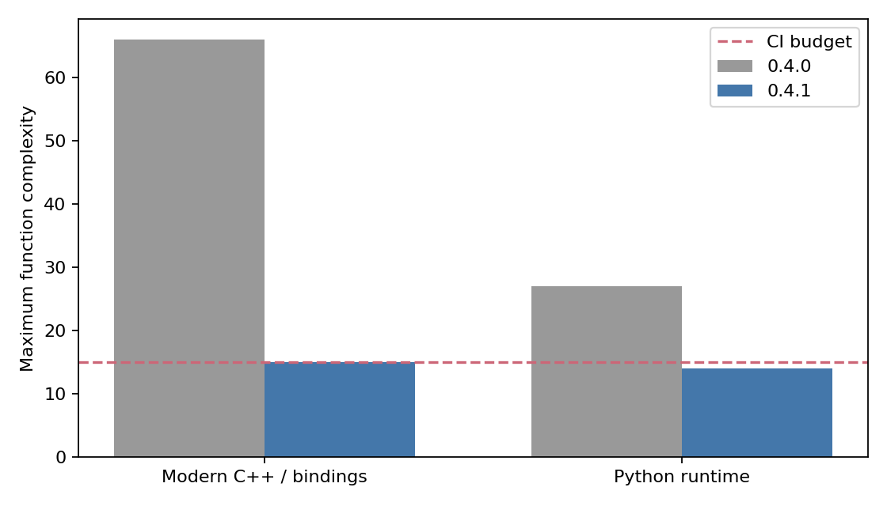
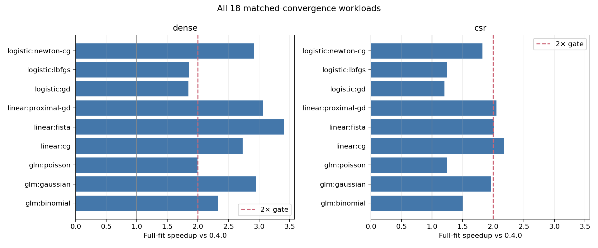

# 代码质量重构与性能验收

**2× gate: 通过; geometric mean full-fit speedup = 2.0337×.**

基线为原始 3374ad2 / 0.4.0，候选为重构后的 0.4.1。所有 18 个主场景均使用相同数据、目标函数和完整梯度精度，且已通过独立数值检查。SGD/Adam 的 4 个固定预算场景单独报告。

汇总规则：先取每个种子内重复中位数，再跨种子取中位数及 IQR。加速比是基线/候选中位数之比，主指标为 18 项加速比的几何平均。完整 fit 包括输入复制、校验和初始化；不是只计最快的 C++ 内核片段。

## 代码质量

| Audit | Before | After | CI budget |
| --- | --- | --- | --- |
| Maximum C++ function complexity | 66 | 15 | 15 |
| Maximum Python runtime function complexity | 27 | 14 | 15 |

数据契约、存储/数值内核、模型目标、求解器状态和绑定注册分别负责独立职责；Python 公开模块只负责导出，估计器直接依赖转换/校验模块。审查范围是现代运行时、公开头文件和绑定，历史实验与生成报告不计入该函数门禁。完整函数清单随原始数据保留。

## 主场景：收敛到相同精度

| Storage | Model/solver | Before fit ms [IQR] | After fit ms [IQR] | Speedup | Max stationarity before/after |
| --- | --- | --- | --- | --- | --- |
| csr | glm:binomial | 22.061 [21.520, 23.014] | 14.603 [14.166, 14.817] | 1.511× | 6.44e-08 / 4.73e-07 |
| dense | glm:binomial | 30.603 [30.356, 30.768] | 13.153 [12.595, 13.467] | 2.327× | 2.35e-10 / 9.41e-08 |
| csr | glm:gaussian | 23.255 [20.935, 24.476] | 11.855 [11.618, 11.897] | 1.962× | 9.89e-07 / 1.94e-07 |
| dense | glm:gaussian | 26.116 [24.847, 26.194] | 8.838 [8.808, 9.026] | 2.955× | 5.63e-09 / 4.85e-08 |
| csr | glm:poisson | 35.196 [35.116, 35.780] | 28.189 [27.846, 28.545] | 1.249× | 3.98e-07 / 4.05e-07 |
| dense | glm:poisson | 34.932 [34.771, 36.949] | 17.528 [17.274, 18.520] | 1.993× | 4.02e-07 / 4.02e-07 |
| csr | linear:cg | 22.385 [21.625, 22.567] | 10.263 [9.992, 10.704] | 2.181× | 6.67e-07 / 6.67e-07 |
| dense | linear:cg | 22.001 [21.741, 22.559] | 8.055 [8.012, 8.285] | 2.731× | 7.30e-07 / 7.30e-07 |
| csr | linear:fista | 30.302 [29.620, 30.437] | 15.106 [14.418, 15.150] | 2.006× | 8.44e-07 / 8.44e-07 |
| dense | linear:fista | 48.584 [48.029, 48.718] | 14.244 [14.056, 14.781] | 3.411× | 5.10e-07 / 5.10e-07 |
| csr | linear:proximal-gd | 23.234 [23.126, 23.319] | 11.323 [11.170, 11.732] | 2.052× | 9.66e-07 / 9.66e-07 |
| dense | linear:proximal-gd | 38.905 [38.721, 41.436] | 12.706 [12.565, 12.841] | 3.062× | 8.51e-07 / 8.51e-07 |
| csr | logistic:gd | 76.799 [76.560, 79.003] | 63.840 [63.666, 63.917] | 1.203× | 9.88e-07 / 9.88e-07 |
| dense | logistic:gd | 102.765 [100.867, 103.714] | 55.767 [54.991, 56.200] | 1.843× | 9.97e-07 / 9.97e-07 |
| csr | logistic:lbfgs | 19.586 [18.905, 19.667] | 15.650 [15.103, 16.060] | 1.251× | 6.76e-07 / 6.76e-07 |
| dense | logistic:lbfgs | 19.963 [19.702, 20.103] | 10.802 [10.526, 11.740] | 1.848× | 8.77e-07 / 8.77e-07 |
| csr | logistic:newton-cg | 26.068 [25.841, 26.873] | 14.272 [13.773, 14.362] | 1.827× | 6.71e-08 / 4.92e-07 |
| dense | logistic:newton-cg | 33.737 [33.343, 34.238] | 11.580 [11.434, 11.779] | 2.913× | 1.26e-09 / 2.17e-07 |

## 随机算法：固定预算

SGD/Adam 使用相同种子、30 个 epoch、batch=256 和固定学习率。此处比较同预算的实际时间及结果一致性，不把预算耗尽称为收敛，也不计入 2× 收敛验收指标。

| Storage | Model/solver | Before ms [IQR] | After ms [IQR] | Speedup | Before/after statuses |
| --- | --- | --- | --- | --- | --- |
| csr | logistic:adam | 129.039 [128.837, 129.746] | 122.664 [121.350, 125.638] | 1.052× | max_epochs / max_epochs |
| dense | logistic:adam | 173.328 [173.123, 174.270] | 91.871 [91.745, 91.904] | 1.887× | max_epochs / max_epochs |
| csr | logistic:sgd | 102.397 [101.649, 106.860] | 96.763 [96.633, 96.914] | 1.058× | max_epochs / max_epochs |
| dense | logistic:sgd | 177.270 [176.327, 177.564] | 93.998 [92.154, 94.016] | 1.886× | max_epochs / max_epochs |

## 核心、预测与内存

以下均为种子中位数。预测耗时含输入转换；RSS 为整个 worker 的 Linux VmHWM，包含解释器、数据生成、预热、NumPy 独立验算和数据，不能解释为求解器增量内存。

| Storage | Model/solver | Core ms before/after | Predict ms before/after | RSS MiB before/after |
| --- | --- | --- | --- | --- |
| csr | glm:binomial | 17.685 / 12.298 | 1.261 / 0.842 | 108.7 / 102.8 |
| dense | glm:binomial | 26.677 / 11.356 | 1.245 / 0.877 | 113.2 / 113.3 |
| csr | glm:gaussian | 19.281 / 8.752 | 1.294 / 0.788 | 108.6 / 102.8 |
| dense | glm:gaussian | 22.226 / 7.013 | 1.181 / 0.825 | 113.2 / 113.2 |
| csr | glm:poisson | 30.437 / 24.986 | 1.278 / 0.880 | 108.6 / 102.8 |
| dense | glm:poisson | 31.182 / 15.071 | 1.141 / 0.858 | 113.2 / 113.2 |
| csr | linear:cg | 16.325 / 7.725 | 1.299 / 0.770 | 108.7 / 102.8 |
| dense | linear:cg | 18.167 / 6.169 | 1.064 / 0.812 | 113.2 / 113.2 |
| csr | linear:fista | 24.774 / 11.735 | 1.176 / 0.827 | 108.7 / 102.8 |
| dense | linear:fista | 44.797 / 12.321 | 1.163 / 0.792 | 113.2 / 113.2 |
| csr | linear:proximal-gd | 18.862 / 8.869 | 1.260 / 0.774 | 108.9 / 103.1 |
| dense | linear:proximal-gd | 35.474 / 10.790 | 1.140 / 0.762 | 113.1 / 113.3 |
| csr | logistic:adam | 124.344 / 119.106 | 1.239 / 0.821 | 108.7 / 102.9 |
| dense | logistic:adam | 170.025 / 89.523 | 1.248 / 0.774 | 113.2 / 113.1 |
| csr | logistic:gd | 71.817 / 60.720 | 1.357 / 0.907 | 108.7 / 102.9 |
| dense | logistic:gd | 95.374 / 53.565 | 1.322 / 0.791 | 113.2 / 113.2 |
| csr | logistic:lbfgs | 15.186 / 12.792 | 1.347 / 0.877 | 108.6 / 102.8 |
| dense | logistic:lbfgs | 16.036 / 8.200 | 1.294 / 0.774 | 113.2 / 113.3 |
| csr | logistic:newton-cg | 20.703 / 11.529 | 1.333 / 0.893 | 108.6 / 102.8 |
| dense | logistic:newton-cg | 29.747 / 9.308 | 1.190 / 0.788 | 113.2 / 113.2 |
| csr | logistic:sgd | 97.120 / 92.353 | 1.335 / 0.823 | 108.7 / 102.8 |
| dense | logistic:sgd | 171.945 / 88.986 | 1.297 / 0.776 | 113.2 / 113.3 |

## 测试集效果

以下为各种子中位数；二项使用 log loss，高斯/泊松使用 MSE。每一对重复的效果差均单独检查，不能通过平均抵消不合格结果。

| Storage | Model/solver | Quality before | Quality after |
| --- | --- | --- | --- |
| csr | glm:binomial | 0.67989918 | 0.67989919 |
| dense | glm:binomial | 0.65031567 | 0.65031567 |
| csr | glm:gaussian | 0.27479837 | 0.27479837 |
| dense | glm:gaussian | 0.25653845 | 0.25653845 |
| csr | glm:poisson | 1.78795622 | 1.78795620 |
| dense | glm:poisson | 1.56489686 | 1.56489689 |
| csr | linear:cg | 0.27479835 | 0.27479835 |
| dense | linear:cg | 0.25653843 | 0.25653843 |
| csr | linear:fista | 0.40274933 | 0.40274933 |
| dense | linear:fista | 0.27374376 | 0.27374376 |
| csr | linear:proximal-gd | 0.40274958 | 0.40274958 |
| dense | linear:proximal-gd | 0.27374386 | 0.27374386 |
| csr | logistic:adam | 0.68853396 | 0.68853396 |
| dense | logistic:adam | 0.65079070 | 0.65079070 |
| csr | logistic:gd | 0.67989909 | 0.67989909 |
| dense | logistic:gd | 0.65031569 | 0.65031569 |
| csr | logistic:lbfgs | 0.67989921 | 0.67989921 |
| dense | logistic:lbfgs | 0.65031559 | 0.65031559 |
| csr | logistic:newton-cg | 0.67989918 | 0.67989917 |
| dense | logistic:newton-cg | 0.65031567 | 0.65031569 |
| csr | logistic:sgd | 0.68078857 | 0.68078857 |
| dense | logistic:sgd | 0.65022242 | 0.65022242 |

## 协议、来源与边界

- CPU: INTEL(R) XEON(R) PLATINUM 8573C; affinity: [0]; threads: {'OMP_NUM_THREADS': '1', 'OPENBLAS_NUM_THREADS': '1', 'MKL_NUM_THREADS': '1'}.
- Python 3.12.14; NumPy 2.3.5; SciPy 1.17.0; libc ['glibc', '2.41'].
- Measured: 2026-11-06T21:13:46.561671+08:00; seeds: [42, 43, 44]; repeats: 3.
- Dense: 24,000 × 96; CSR: 24,000 × 2,000, density 1%; training 80%, held-out 20%.
- L2=.1; linear proximal solvers additionally use L1=.01. Unpenalized intercept; primary tolerance=1e-6.
- SGD learning rate=.03; Adam=.003. Primary budgets: logistic/GLM 300, linear 1,000; actual work retained.
- Baseline runtime: {'simd': 'compiler_default'}; candidate: {'simd': 'avx2_fma', 'vector_math': 'glibc_libmvec'}.

每次主拟合必须同时满足收敛状态和独立重算的梯度/近端映射范数 ≤1.00001e−6。配对目标差 ≤1e−9、系数差 ≤3e−5（另有1e−5相对项）、测试指标差 ≤2e−5。指标为二项 log loss，或高斯/泊松 MSE；这些阈值没有因优化而放宽。

二进制、源文件和数据校验和、实际编译配置均保留。两边使用相同 Release 编译器和基础优化级别，候选通过运行时检测使用可选 SIMD/系统向量数学，未启用 fast-math 或额外线程。部分求解器减少了重复扫描/内层工作，因此不是相同指令数的微基准。

结果来自固定规模的合成数据和当前 CPU。虽固定了单核与线程数，仍未隔离 CPU 频率和宿主机负载；三个种子不能覆盖所有数据条件。几何平均达标不代表每个场景都达标；可选后端不可用时应重新测量。标量与向量数学可能有末位舍入差异。

[Raw measurements and histories](../../results/2026-11-06-refactor/results.json) · [Baseline audit](../../results/2026-11-06-refactor/quality-before.json) · [Candidate audit](../../results/2026-11-06-refactor/quality-after.json)

Design, exact commands and ownership/numerical contracts: [refactoring guide](../../../docs/refactoring.md). Content hashes for this report and its generator are in `report-manifest.json`.

[包含未达标版本的开发实验记录](../../results/2026-11-06-refactor/development-attempts.md)
