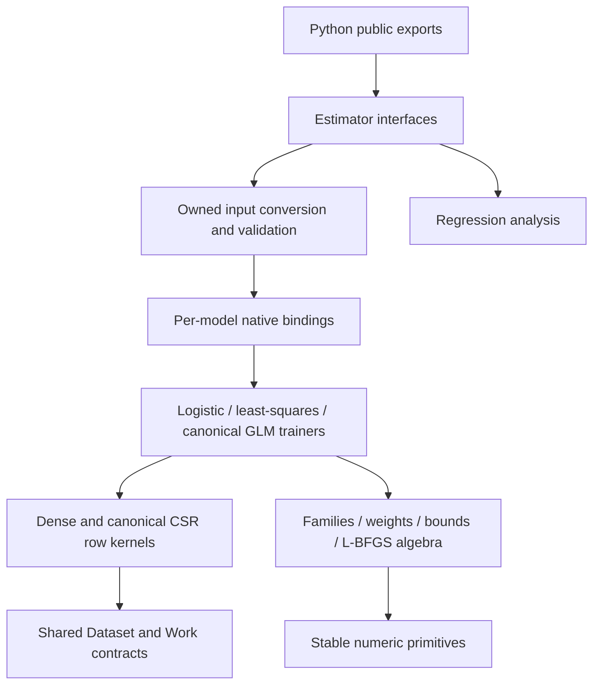

# Runtime refactoring and performance acceptance

This change reviews the maintained C++ model runtime, public headers, Python bindings, estimator interfaces and OLS analysis together. It separates mathematical responsibilities and measures complete Python-facing fits against the preserved **3374ad2 / 0.4.0** implementation. Historical executables remain compatibility targets in CI; archived research results retain their original binaries' interpretation.

## Responsibilities and dependencies



- **Shared contracts:** `include/logitlab/dataset.hpp` owns Dataset/Work declarations. Linear and GLM headers no longer acquire a dependency on the logistic estimator to use data storage. Existing declarations remain in the same C++ namespace.
- **Storage and numeric primitives:** `src/dataset.cpp` owns structural validation and public row operations. Private row views dispatch dense/CSR storage once per pass. `src/detail/` contains numerical reductions, stable response families, observation masses, separable bounds and L-BFGS history. These components do not own optimizer iteration policy.
- **Trainers:** Logistic and linear fit loops delegate initialization, a solver step, line search, history and termination to named methods. GLM trial handling and response-family operations are separate. A failed trial cannot publish coefficients or overwrite accepted curvature.
- **Bindings:** Dataset conversion and each model register in separate translation units. Each model includes only its private adapter API; `bindings/python.cpp` is registration glue. Options are still snapshotted before releasing the GIL.
- **Python:** `__init__.py` is an export facade. Estimators use `_data.py` and `_validation.py` directly instead of importing conversion helpers from the facade. OLS validation and coefficient presentation are separate from covariance estimation. Existing public estimator names, parameters and result attributes remain available.

The pinned Lizard/Radon audit measures all modern C++ runtime/public-header/binding functions and all Python runtime functions. The largest C++ function complexity falls from **66 to 15**; Python falls from **27 to 14**. This is a per-function bound, not a claim that the sum of every branch in the repository fell by that percentage. The exact function inventory is retained with the performance report. CI rejects functions above 15 and checks Python formatting and undefined names.

## Performance changes and numerical contracts

1. Inline dense/CSR row views remove repeated storage dispatch. Independent accumulation lanes improve reduction throughput without global reassociation flags. Dense AVX2/FMA operations are selected only after CPU detection; canonical CSR permits independent packets of gradient updates because indices are unique.
2. Canonical response families reuse an exponential for loss, gradient and curvature. Four-observation batches can call the optional **system glibc libmvec** double-precision exp/log1p ABI. Scalar standard-library math remains available. CMake verifies the required symbols rather than assuming a particular OS package exists. No source from glibc is bundled, and no fast-math flag is enabled.
3. Logistic Newton-CG reuses curvature from accepted joint evaluations and adapts inner solve accuracy to the full-gradient norm. Nonlinear Newton-CG inner residual targets need not fall below half the requested outer tolerance; Gaussian solves use that absolute target directly. The outer loop still checks a fresh complete gradient against the original requested threshold. This avoids oversolving local linear models. GD learning-rate semantics and stochastic schedules remain unchanged.
4. Least-squares CG uses quadratic recurrences, with periodic/full final residual refresh. Proximal methods reuse the affine gradient of the extrapolated point, periodically refreshing and restarting as needed. Final convergence and accepted proximal gradients still come from full evaluations.
5. The binding converts common SciPy int32 indices directly into owned size_t storage, reserving capacity once. It also supports int64 and noncontiguous arrays. Negative/invalid indices, offsets and targets still fail validation.
6. An immutable Python-owned Dataset has already passed storage checks. Private binding adapters avoid a second storage scan while checking target shape/domain and all model options. Mutable public C++ Dataset entry points always validate storage again. No unsafe validation cache is added to the public Dataset struct.
7. The default unbounded linear model passes empty native bound vectors instead of materializing two feature-sized arrays and lists. Intercept bounds retain their separate validation/inference contract. GLM coefficients cross the Python boundary once when fitted state is published.
8. The finite-value predicate uses an ordered AVX2 comparison when supported, rejecting NaNs and either signed infinity, with a scalar tail/fallback. Initial objective passes skip feature dot products only when all feature coefficients are exactly zero; gradients, curvature and penalties are still evaluated normally.
9. Sparse conversion validates owned compressed storage before canonicalization. When `tocsr(copy=False)` returns that same checked object, the second SciPy format check is redundant; newly converted storage is checked normally. Native storage validation still follows canonicalization.

Floating-point rounding can differ between reduction orders, FMA and vector/scalar math. The numerical objective, regularization normalization, target domains, ownership guarantees and final tolerance are preserved. The performance comparator independently recomputes the penalized objective, gradient/proximal-gradient mapping, coefficients and held-out quality; it does not trust `converged_` alone. Work counters now reflect avoided traversals rather than requiring an evaluation for every history row.

The fast paths remain single-threaded and in-memory. `LOGITLAB_SIMD=OFF` or `LOGITLAB_DISABLE_SIMD=1` exercises the portable path. `LOGITLAB_VECTOR_MATH=OFF` omits libmvec. The vector-math ABI requires matching system symbols (including glibc's vector log1p ABI); generic Linux wheels are not claimed to be manylinux-portable to older glibc versions. CMake disables the backend when unavailable.

## Paired acceptance protocol

`benchmarks/refactor.py` fixes **18 primary workloads** before timing: dense/CSR × logistic GD, L-BFGS, Newton-CG; linear CG, proximal GD, FISTA; and Gaussian/Binomial/Poisson GLM. Four additional dense/CSR SGD/Adam workloads use a separately reported fixed-budget track. They are not mixed with converged-fit timing.

- Dense data: 24,000 × 96. CSR: 24,000 × 2,000, density 1%. Both use 80/20 training/held-out splits from deterministic generators. All candidates receive the same matrix, labels, penalty and stopping precision.
- Primary fits require reported convergence **and** an independently recomputed gradient/mapping norm ≤ 1.00001e−6. Paired objectives must agree within 1e−9; coefficients within the declared 3e−5 absolute / 1e−5 relative bounds; held-out metrics within 2e−5. Missing/duplicate slots and changed datasets invalidate the comparison.
- Use three seeds (42/43/44) and three measured repeats. Warm up the API first, pin both artifacts to one allowed CPU, set BLAS/OpenMP threads to one, and alternate artifact order. Dataset generation and imports are excluded; the fit timer includes Python conversion, validation, initialization and optimization.
- Aggregate repeats within each seed, then seeds. Report median/IQR fit latency, core time, prediction latency, statuses, objective/stationarity and whole-worker Linux VmHWM. RSS includes interpreter, generated data and warm-up; it is not an incremental solver allocation.
- The predeclared performance gate is a **geometric mean full-fit speedup of at least 2× across all 18 primary workloads**. Individual workloads and the stochastic track remain visible. Quick runs or a one-seed preflight are not acceptance evidence.
- Preserve native module SHA-256, runtime backend, dataset hashes, source hashes, actual retained build-cache flags, compiler/runtime versions and CPU affinity. Reject source/artifact changes during measurement. No build or test process runs concurrently with the final timing experiment.

Example after preparing two isolated package directories and their retained build caches:

```bash
python benchmarks/refactor.py \
  --before /path/to/baseline-package --before-source /path/to/3374ad2-source \
  --before-build /path/to/baseline-wheel-build \
  --after /path/to/candidate-package --after-source "$PWD" \
  --after-build /path/to/candidate-wheel-build \
  --output build/refactor-results
```

The measured [中文报告](../benchmarks/reports/2026-11-06-refactor/refactor.zh-CN.md) and [English report](../benchmarks/reports/2026-11-06-refactor/refactor.en.md) retain the complete primary/secondary tables and raw evidence. The report, not the existence of an optimization branch, determines whether the 2× gate passed.

Generate both reports and figures from the retained measurements and full complexity inventories:

```bash
python tools/check_quality.py --root /path/to/3374ad2-source --output build/refactor-results/quality-before.json
python tools/check_quality.py --output build/refactor-results/quality-after.json
python benchmarks/refactor_report.py --input build/refactor-results --output build/refactor-report
```

The baseline audit intentionally exceeds the new budget and returns a failing exit status while writing its inventory. That failure is evidence of the original state; candidate CI must pass the same default budget. The report rejects incomplete or quick runs.

## TDD and verification

The new shared-kernel test initially failed because its private headers did not exist; the Python import contract failed because model modules were still coupled through `__init__.py`. The green checks cover independent row/Hessian-vector operations, scalar/vector response accuracy, extreme/NaN norms, normalized weights, invalid-storage rejection before allocation, immutable binding data, int32/int64/strided CSR input, zero-weight extreme rows, unchanged model references and benchmark accuracy/completeness guards.

The old linear work-count assertions assumed one full scan per iteration. They now verify actual traversal accounting and independently check the final normal equations. No numerical tolerance was relaxed to accommodate recurrences or SIMD. Release, ASan/UBSan/LeakSanitizer, portable-backend, source-package/wheel and Python checks provide complementary evidence.

Local verification on 2026-11-06: **253 Python tests passed from the installed candidate package**, with **99.68% Python statement coverage**. The forced-scalar subset passed **115 tests**. Independent sdist → wheel builds also passed the full suite; after removing the final redundant Python CSR check, the package was rebuilt and its conversion/API contracts rechecked. Release, `LOGITLAB_SIMD=OFF` and ASan/UBSan/LeakSanitizer each passed all **7 CTest entries**. The archived baseline passed its original **240 Python tests**. Python coverage does not measure native C++; the independent native references and sanitizers cover that layer separately. GitHub Actions repeats source-package/wheel validation and checks GCC/Clang and Python 3.10/3.12.

## 中文说明

本次重构覆盖现代 C++ 核心、公开头文件、Python 绑定、估计器及回归分析。重点是分离数据契约、数值内核、模型目标与求解器状态，解除 Python 循环依赖，并建立每函数圈复杂度不超过 15 的 CI 门禁。

性能验收使用预先固定的 18 个收敛场景，加上 4 个独立的随机算法固定预算场景。主指标是完整 fit 耗时的几何平均加速至少 2×；输入转换和校验开销包括在内，最终梯度精度及预测效果保持原标准。所有场景均保留，不只展示最优结果。具体加速、较慢场景、内存和适用范围以关联评测报告为准。
